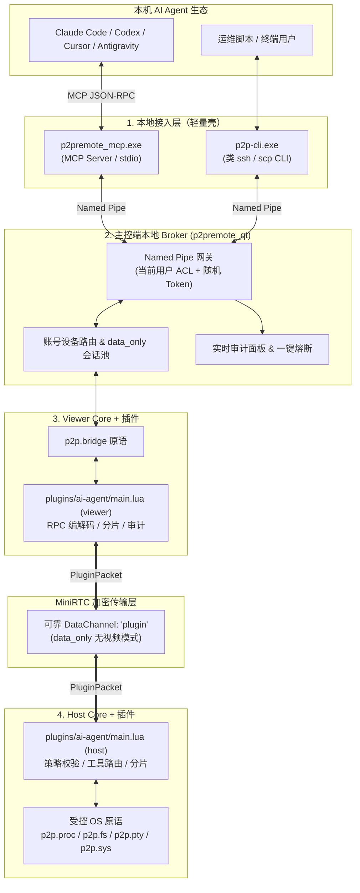

# P2P Remote AI Agent 远程接入与管理设计方案

## 已交付的只读诊断

Qt 主控可以在已建立的远程会话中获取 Windows 系统摘要。被控端在「设置 → AI Agent」开启「允许已连接的主控查看本机系统摘要」后，主控端可从「工具 → AI Agent 系统摘要…」发起查询。开关默认关闭。每次查询都须由被控端 Qt 客户端批准，15 秒未确认自动拒绝。提示显示期间，当前远程会话的 P2P Remote 键鼠输入暂停。无人值守服务没有批准界面，查询会到期。

摘要包含 Windows 版本和构建号、处理器架构和逻辑处理器数量、物理内存、开机时长、系统盘剩余及总容量，以及主机名和被控程序运行账户及其提权状态。诊断窗口提供「导出诊断快照…」，由用户在主控端选择保存位置。

被控端「我的设备」和系统托盘提供诊断记录与暂停入口。暂停会关闭被控端诊断授权并撤销待审批请求，桌面会话可继续使用。日志位于本机插件配置目录，采用 JSONL，记录时间、请求编号、操作名称、结果和耗时。日志按 UTC 日期及 256 KiB 上限轮转，保留最近一份归档。

### 实时查询

主控端登录后，在已连接的设备标签页选择「操作 → 共享诊断给本机 Agent…」。窗口显示临时共享码，响应仅对同一台机器、同一 Windows 用户及登录会话内的客户端开放。共享码仅在本次共享中有效，可通过会话菜单、对话框或系统托盘停止共享。会话断开时共享自动结束。

可在「我的设备」选中目标后点击「只读诊断」，建立独立的纯数据会话。两端使用新版 Qt 客户端，账号信令服务也需更新。被控端开启至少一项 AI Agent 授权并启动交互式接收后，才接受这类连接。纯数据会话只载入内置诊断插件，不启动连续抓屏、音频、编解码、键鼠控制或远程终端。同一被控设备同一时间接收一条会话，正在使用时会显示忙碌状态。

```powershell
.\p2p-cli.exe devices --live '<共享码>'
.\p2p-cli.exe system-info --live '<共享码>' '<设备 ID>'
.\p2p-cli.exe screen-snapshot --live '<共享码>' '<设备 ID>'
```

`devices` 使用当前账号的设备列表，并通过 `shared_device_id` 指明可查询的设备。实时 `system-info` 仍会在被控端弹出本次审批。停止共享或本机工具在等待期间退出会取消请求。

MCP 使用 stdio，协议版本为 `2025-11-25`。启动参数 `--live <共享码>` 会注册 `list_devices` 和 `system_info`。共享纯数据会话时还会注册 `screen_snapshot`。系统摘要、截图和报告需要 `device_id`，可通过 `notifications/cancelled` 取消待审批请求。共享码应随使用会话传入，避免写入共享配置或日志。

`screen_snapshot` 仅在纯数据会话可用。被控端在「设置 → AI Agent」单独开启截图权限，并逐次批准。批准后抓取开始接收时所选显示器的一帧，生成分辨率不超过 1280 × 720、最大 512 KiB 的 PNG。MCP 以原生图像内容返回，CLI 以 JSON 的 `image_png` 字段返回 Base64。锁屏或安全桌面下无法采集。审计记录操作和结果，截图内容仅在会话内传输。

```json
{
  "mcpServers": {
    "p2premote-diagnostics": {
      "command": "E:/2026/p2premote/dist/app/p2premote_mcp.exe",
      "args": ["--live", "<本次共享码>"]
    }
  }
}
```

### 插件注册只读报告

主控端已启用的 Viewer 插件可在 `plugin.json` 中声明 `agent_reports`。

```json
"agent_reports": [
  {
    "id": "capacity",
    "fields": ["system_disk_total_mib", "system_disk_free_mib", "memory_available_mib"]
  }
]
```

例如 `office` 插件的报告工具名称为 `plugin_office_capacity`。报告 ID 可使用小写字母、数字和连字符。重新开启诊断共享后，MCP 的 `tools/list` 会列出已注册报告。调用仍走被控端系统摘要审批，结果只包含声明的字段。可用字段包括 Windows 版本、架构、逻辑处理器数量、内存、开机时长及系统盘容量。清单每条报告最多声明 8 个字段，包含未许可字段的报告不会注册。

### 导出快照

也可用本地命令行读取同一份快照：

```powershell
.\p2p-cli.exe system-info --snapshot 'C:\Diagnostics\p2premote-diagnostics.json'
```

本地 Agent 可启动只读 MCP 工具，传入导出的 JSON 文件绝对路径。整个进程只使用启动时加载的快照。更新快照后，重启 MCP 工具以加载新文件。

```json
{
  "mcpServers": {
    "p2premote-diagnostics": {
      "command": "E:/2026/p2premote/dist/app/p2premote_mcp.exe",
      "args": ["--snapshot", "C:/Diagnostics/p2premote-diagnostics.json"]
    }
  }
}
```

将示例路径替换成实际路径。快照模式下的 `system_info` 无需参数。只读诊断使用已登录的 Qt 客户端选择设备，审批在被控端交互式桌面完成。下文保留原始规划，其中独立守护进程、通用远端命令、文件和隧道接口未纳入当前版本。

## 1. 背景与设计目标

本方案旨在利用 `p2premote` 现有的 **P2P NAT 穿透、端到端加密通道、账号设备发现、Windows 无人值守服务与 Lua 插件体系**，为本地 AI Agent（如 Claude Code、Codex、Cursor、Antigravity、T3 Code 或自定义脚本）提供类似 SSH 的远程电脑接入与管理能力。

### 核心目标
1. **免公网 IP / 免 SSHD 部署**：复用现有账号与 P2P 通道，直接管理内网/家庭/办公 Windows 设备。
2. **深度融入现有插件体系**：遵循 [lua-plugin-design.md](lua-plugin-design.md) 的边界原则——**C++ 核心仅提供少量通用、受控原语，全部 Agent 业务协议、工具定义、权限策略与设置 UI 均由 `plugins/ai-agent/` 插件实现**。
3. **无头低开销连接**：支持纯数据通道会话（不启动桌面抓屏、视频编码与渲染窗口），适合多设备并发运维。
4. **默认安全可控**：显式开关、分级权限策略、实时审计与一键熔断。
5. **保持架构红线**：`p2premote_core.dll` 保持 100% 零 Qt 依赖；所有子进程与 IO 均异步执行，绝不阻塞插件工作线程或渲染线程。

---

## 2. 总体架构与职责划分



### 分层职责矩阵

| 层级 | 模块位置 | 职责 | 说明 |
| :--- | :--- | :--- | :--- |
| **本地接入层** | `tools/mcp/`（新增）<br>`tools/cli/`（Phase 2） | 对外暴露标准 MCP（stdio）与类 SSH CLI | 轻量无状态转发器，不存账号密码 |
| **本地 Broker** | `viewer/qt/`（新增模块） | 复用已登录账号，管理 `list_devices` 与 `data_only` 连接池，承载审计 UI 与熔断开关 | 仅监听当前用户可访问的 Named Pipe |
| **Core 层（C++）** | `core/` | 1. `data_only` 无头会话模式<br>2. `p2p.bridge` 外部请求桥接 ABI<br>3. `p2p.proc` / `p2p.sys` 异步 OS 原语 | 通用能力，零 Qt 依赖，其他插件亦可复用 |
| **插件层（Lua）** | `plugins/ai-agent/` | 跨端 RPC 协议与分片、工具路由、权限策略校验、配置页（`settings_ui`）、顶栏状态与审计弹窗 | 业务迭代只需改 Lua，无需重编 C++ |

---

## 3. 关键技术设计

### 3.1 Core 无头纯数据会话（`data_only`）
- 在 `core/include/p2premote/core_api.h` 的 `p2p_connection_options_v1`（或同步升级 `P2P_CORE_ABI_VERSION`）中增加 `int32_t data_only`。
- 当 `data_only == 1` 时：
  - Viewer 侧允许 `video_parent == nullptr`，不创建子窗口、D3D11 设备、视频解码器与音频播放器；
  - Host 侧不启动 DXGI/WGC 抓屏、H.264 编码器与音频采集；
  - 正常完成信令协商、ICE/DTLS 建连、SRTP 数据保护与 `"plugin"` DataChannel 建链，启动 `PluginHost`。
- 同一个账号可同时维护多条 `data_only` 会话，互不干扰，也与现有桌面视频会话兼容。

### 3.2 新增 Core 插件原语（受 `plugin.json` 权限控制）

| 命名空间 | 权限名 | 角色 | 接口定义 | 约束与实现要点 |
| :--- | :--- | :--- | :--- | :--- |
| `p2p.proc` | `"proc"` | `host` | `exec(spec, on_done) -> run_id`<br>`cancel(run_id)` | C++ 后台线程池异步执行 `CreateProcessW`（支持 `powershell` / `cmd` / 指定可执行文件、`cwd`、`env`、`timeout_ms`）；捕获并统一将控制台输出转为 UTF-8；单次输出上限默认 128 KiB（超长返回 `truncated=true`）。 |
| `p2p.sys` | `"sys"` | `host` | `info() -> table` | 只读返回主机名、OS 版本、架构、CPU 核数、内存总量/可用量、磁盘列表、当前用户名、是否管理员权限。 |
| `p2p.bridge` | `"bridge"` | `viewer` | `on_request(fn)`<br>`respond(req_id, payload)` | 将 C ABI 注入的本机网关请求投递至 Lua，Lua 完成远端交互后回传结果；单插件有界队列，防内存膨胀。 |

C ABI 侧对应在 `core/include/p2premote/core_api.h` 增加通用插件桥接函数（零 Qt 依赖）：
- `p2p_stream_plugin_request(stream, plugin_id, type, payload, len, &req_id)`
- `p2p_stream_poll_plugin_response(stream, &resp)`

### 3.3 `plugins/ai-agent/` 插件设计

#### 清单声明（`plugins/ai-agent/plugin.json`）
```json
{
  "id": "ai-agent",
  "name": "AI Agent 远程管理",
  "version": "1.0.0",
  "description": "允许本地 AI Agent 通过 P2P 加密通道安全管理远程电脑",
  "entry": "main.lua",
  "enabled": true,
  "roles": ["host", "viewer"],
  "permissions": ["channel", "bridge", "proc", "fs", "pty", "sys", "config", "ui", "log"],
  "settings_ui": {
    "mode": "page",
    "page": "ai-agent",
    "page_title": "AI Agent",
    "nav_group": "软件设置",
    "section": "AI Agent 接入与权限",
    "order": 60
  },
  "settings": [
    { "key": "allow_host_access", "label": "允许本机作为 AI Agent 被控端", "type": "bool", "default": false },
    { "key": "policy_mode", "label": "权限模式", "type": "select", "default": "guarded",
      "options": [
        { "value": "read_only", "label": "只读诊断" },
        { "value": "guarded", "label": "受控运维（拦截高危操作）" },
        { "value": "full_access", "label": "完全托管" }
      ]
    },
    { "key": "default_timeout_ms", "label": "默认命令超时 (ms)", "type": "int", "default": 30000, "min": 1000, "max": 300000 },
    { "key": "allowed_roots", "label": "受控模式允许写入的根目录（分号分隔）", "type": "string", "default": "" }
  ]
}
```

#### 跨端 RPC 分片协议
由于单帧 `PluginPacket` 上限 64 KiB、Lua VM 内存上限 2 MiB，插件内部使用轻量化分片信封：
- 消息类型：`rpc_req`、`rpc_chunk`、`rpc_resp`、`rpc_cancel`。
- 单条 JSON payload 超过 48 KiB 自动分块发送，对端按 `req_id + seq + total` 重组；大文件传输直接复用流式分块读写与 SHA-256 校验。

#### 暴露给本地 AI Agent 的标准工具集（MCP Tools）

| 阶段 | Tool 名称 | 执行位置 | 功能描述 |
| :--- | :--- | :--- | :--- |
| P1 | `list_devices` | 本地 Broker | 列出当前账号下设备、在线状态及 Agent 接入状态 |
| P1 | `system_info` | Host 插件 | 返回远端 OS、硬件、磁盘、用户及权限级别 |
| P1 | `exec` | Host 插件 | 执行 PowerShell/CMD 命令，结构化返回 `exit_code` / `stdout` / `stderr` / `timed_out` |
| P1 | `fs_list` | Host 插件 | 列出目录内容（文件名、类型、大小、修改时间） |
| P1 | `fs_read` | Host 插件 | 按行范围或字节偏移读取远端文本/配置文件（适合读大日志） |
| P1 | `fs_write` | Host 插件 | 写入或覆盖远端文件（支持原子替换） |
| P1 | `fs_replace` | Host 插件 | 按精确片段替换远端配置文件内容，减少传输与误改风险 |
| P2 | `fs_upload` / `fs_download` | Host 插件 | 本地与远端之间的大文件断点续传与校验 |
| P2 | `pty_open` / `pty_write` / `pty_read` / `pty_close` | Host 插件 | 持久交互式 ConPTY 终端会话 |
| P3 | `screen_snapshot` | Host 插件 | 按需抓取远端单帧桌面截图（JPEG/PNG），供多模态 Agent 诊断 GUI 问题 |

### 3.4 安全与权限模型
1. **被控端显式开启**：`allow_host_access` 默认为 `false`，未开启时直接拒绝所有 `ai-agent` RPC 请求。
2. **本机 IPC 隔离**：Named Pipe（`\\.\pipe\p2premote-agent-<SID>`）配置严格 Windows DACL（仅允许当前登录用户 SID 访问），并校验随机生成的本机 Token（存于 `%LOCALAPPDATA%\P2PRemote\agent-ipc.json`，权限仅当前用户可读）。
3. **三级策略（Host 端强制校验，不信任 Viewer 端）**：
   - `read_only`：仅放行 `system_info`、`fs_list`、`fs_read` 与只读白名单命令。
   - `guarded`：放行常规读取、指定 `allowed_roots` 内写入及普通命令；拦截高危命令（如 `format`、`bcdedit`、`reg delete`、关机重启、修改系统目录等）或在 Phase 2 弹窗人工确认。
   - `full_access`：放行全部工具调用，适合个人无人值守开发机/测试机。
4. **审计与熔断**：每次调用均记录 `{time, device, tool, summary, exit_code, duration_ms}`；主控端可随时一键断开所有 Agent 会话。

---

## 4. 分阶段实施计划

### Phase 1：最小可用闭环（MVP —— 跑通本地 MCP 管理远端电脑）

**阶段目标**：在 Claude Code / Codex / Cursor / Antigravity 中配置 `p2premote_mcp.exe` 后，能够零配置穿透内网，查看在线设备并执行远端命令、查看系统信息、读写远端配置文件。

#### 工作清单
1. **Core 无头会话能力**
   - 修改 `core/include/p2premote/core_api.h`、`core/include/p2premote/connection_options.h`、`core/src/core_stream_api.cpp`：新增 `data_only` 选项，允许无 `video_parent` 建连并跳过抓屏/视频编解码。
   - 验证 Host 在桌面模式与 Windows 服务模式（`host/service_main.cpp`）下均可接受 `data_only` 会话。
2. **Core 通用插件原语**
   - 在 `core/src/plugin_host.cpp` 中新增 `p2p.proc`（异步子进程执行 + 超时终止 + UTF-8 转码）、`p2p.sys`（系统信息查询）和 `p2p.bridge`（外部请求/响应桥接）。
   - 在 `core/include/p2premote/core_api.h` 暴露 `p2p_stream_plugin_request` / `p2p_stream_poll_plugin_response`。
   - 补充 `core/src/plugin_host_test.cpp` 单元测试（覆盖 `proc` 正常输出/超时/取消/编码转换、`sys`、`bridge` 权限隔离）。
3. **`plugins/ai-agent/` 插件初版**
   - 新增 `plugins/ai-agent/plugin.json` 与 `plugins/ai-agent/main.lua`。
   - 实现 `rpc_req` / `rpc_chunk` / `rpc_resp` 分片通信。
   - 实现 Host 侧 `system_info`、`exec`、`fs_list`、`fs_read`、`fs_write`、`fs_replace` 工具处理与基础权限开关校验（`allow_host_access` + `read_only` / `guarded` / `full_access` 规则表）。
   - 接入设置中心 `AI Agent` 配置页。
4. **主控端本地 Broker**
   - 在 `viewer/qt/` 新增 `agent_broker.h/.cpp`：启动本机 Named Pipe 服务、维护按设备 ID 复用的 `data_only` 会话池（含空闲超时自动回收）、处理 `list_devices` 与插件请求转发。
5. **本地 MCP Server**
   - 新增轻量可执行文件 `p2premote_mcp.exe`（纯 C++/Win32，零 Qt 依赖）：实现标准 MCP `stdio` JSON-RPC 2.0（`initialize`、`tools/list`、`tools/call`），通过 Named Pipe 与 `p2premote_qt` 通信。
   - 更新 `CMakeLists.txt` 与打包脚本 `tools/Package-Windows.ps1`，将 `p2premote_mcp.exe` 与 `plugins/ai-agent/` 纳入构建和发布。

#### Phase 1 验收标准
- `p2premote_core.dll` 及全部回归测试通过，零 Qt 依赖检查通过。
- 本地运行 `p2premote_qt.exe` 登录后，通过 MCP Inspector 或 Claude Code / Codex 调用 `list_devices` → `system_info` → `exec` → `fs_read` / `fs_replace` 全链路打通。
- `data_only` 会话期间 Host 端 CPU 占用接近 0%，不触发抓屏和编码。
- Host 端未开启 `allow_host_access` 时，所有远程工具调用均被明确拒绝。

---

### Phase 2：安全可控、可视化审计、CLI 与交互式终端

**阶段目标**：让 AI 远程管理真正具备生产可用的安全性与可观测性，同时补齐命令行工具（类 SSH）与长会话终端能力。

#### 工作清单
1. **可视化审计与一键熔断 UI**
   - 在 `plugins/ai-agent/` 中通过 `p2p.ui` 注册状态提示与审计日志弹窗；在主控端托盘/主窗口显示当前活跃的 Agent 会话数与一键“断开所有 Agent 连接”按钮。
   - 本地持久化结构化审计日志（滚动保留，按天/大小轮转）。
2. **受控模式交互审批（Guarded Approval）**
   - 当 Host 策略为 `guarded` 且命中高危操作（提权、敏感路径写入、黑名单命令）时，支持向主控端推送审批请求（超时自动拒绝），用户确认后放行。
3. **类 SSH 命令行工具（`p2p-cli.exe`）**
   - 复用与 `p2premote_mcp.exe` 相同的 Named Pipe 客户端协议，提供：
     - `p2p-cli devices`
     - `p2p-cli exec <device> "<cmd>"`
     - `p2p-cli cp <local> <device>:<remote>` / `p2p-cli cp <device>:<remote> <local>`
     - `p2p-cli shell <device>`（交互式终端直连）
4. **ConPTY 长会话与大文件传输 Tool**
   - 在 `plugins/ai-agent/main.lua` 中接入 `p2p.pty`，暴露 `pty_open` / `pty_write` / `pty_read` / `pty_close`，支持需要持久环境或交互输入的场景。
   - 暴露 `fs_upload` / `fs_download`，复用断点续传与 SHA-256 校验。
5. **独立无头模式（可选）**
   - 支持 `p2premote_mcp.exe --standalone` 或无 GUI 守护模式，允许在未打开 `p2premote_qt.exe` 的纯命令行环境下读取本机凭据直接建连。

#### Phase 2 验收标准
- 高危命令在 `guarded` 模式下能准确拦截并触发审批/拒绝，审计日志完整可查。
- 主控端点击“一键断开”可在 1 秒内终止正在运行的远端命令并关闭 `data_only` 会话。
- `p2p-cli` 的 `devices` / `exec` / `cp` / `shell` 在局域网与公网穿透场景下均可稳定使用。

---

### Phase 3：视觉感知与高级生态扩展（进阶演进）

**阶段目标**：发挥 `p2premote` 相对传统 SSH 的差异化优势，支持多模态视觉辅助与标准网络隧道。

#### 工作清单
1. **按需单帧桌面截屏（`p2p.screen` 原语 + `screen_snapshot` Tool）**
   - Core 层提供按需捕获单帧桌面并压缩为 PNG/JPEG 的低开销原语（不拉起持续视频流）。
   - `ai-agent` 插件将其封装为 `screen_snapshot`（受独立权限开关控制），返回给多模态 AI Agent 识别弹窗、报错界面与 GUI 状态。
2. **P2P 本地 TCP 端口转发（可选）**
   - 在 DataChannel 上实现轻量多路复用流（TCP Tunnel），允许本地将 `127.0.0.1:<local_port>` 映射到远端指定端口，兼容标准 `ssh`、VS Code Remote-SSH、远程数据库与 Web 调试面板。
3. **第三方 Agent 技能插件扩展**
   - 允许其他 Lua 插件声明向 `ai-agent` 注册自定义只读/运维 Tool（如“查询某业务日志”、“重启指定服务”），进一步降低 AI 误操作风险。

#### Phase 3 验收标准
- 多模态 Agent 可在无视频串流状态下按需获取清晰桌面截图，单次截图延迟 < 1 秒。
- 端口转发稳定承载高频 TCP 流量且具备独立端口白名单限制。

---

## 5. 关键风险与缓解措施

| 风险点 | 影响 | 缓解方案 |
| :--- | :--- | :--- |
| **命令输出或文件内容过大** | 触发 64 KiB 单帧或 2 MiB Lua VM 内存上限，或撑爆 AI 上下文 | C++ `p2p.proc` 限制单次捕获上限（默认 128 KiB），超长内容落临时文件并返回路径供 `fs_read` 分页读取；插件层统一做 48 KiB 分片 |
| **Windows 控制台乱码** | PowerShell/CMD 默认代码页（GBK/CP936）导致 AI 读到乱码 | `p2p.proc` 启动子进程时强制设置 UTF-8 输出或由 C++ 检测并统一转码为 UTF-8 |
| **同机其他进程越权调用 IPC** | 本机恶意/低权进程借已登录的 `p2premote_qt` 操作远端机器 | Named Pipe 严格限定当前用户 SID 的 DACL + 每次启动刷新随机 Token 文件 |
| **死循环/卡死命令阻塞插件线程** | 影响剪贴板、文件传输等其他插件 | `p2p.proc` 全程在独立线程池运行并配合 Windows Job Object，超时/断开时连同子进程树一并终止 |
