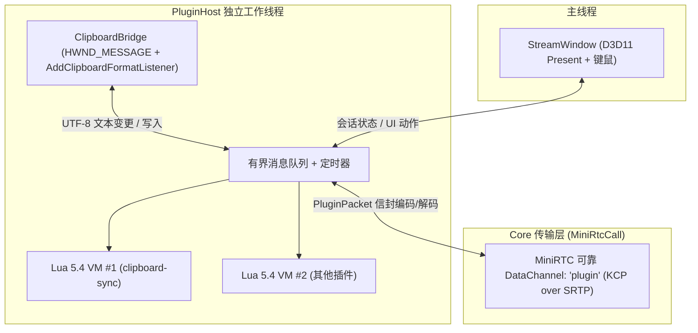

# P2P Remote Lua 插件系统设计方案（v1）

## 1. 设计目标与边界

将 `p2premote` 拆分为 **C++ 实时核心** 与 **Lua 5.4 插件扩展层**：

- **C++ 核心（固定且高实时）**：负责网络建连（信令 / ICE / SRTP）、MiniRTC 媒体与数据通道、DXGI/WGC 采集、硬件 H.264 编解码、D3D11 上屏、低延迟键鼠主通路，以及安全受控的 OS 原语桥接。
- **Lua 5.4 插件层（灵活可扩展）**：负责剪贴板同步、快捷指令/宏、输入法与锁定键辅助、智能画质策略、文件传输等办公工作流与扩展协议。

### 核心约束
1. **零渲染/输入阻塞**：Lua 虚拟机运行在独立插件工作线程，绝不阻塞 `StreamWindow` 主线程的 D3D11 `Present()` 与鼠标采集。
2. **沙箱与权限隔离**：每个插件运行在独立的 `lua_State` 中，按 `plugin.json` 声明授予能力；默认禁止 `io` / `os` / `package` / `debug` / `dofile` / `loadfile`，并启用指令计数看门狗防止死循环卡死插件线程。
3. **单一复用通道**：在 MiniRTC 中只新增 **1 条通用可靠 DataChannel（`"plugin"`）**，所有插件通过统一信封按 `plugin_id` 路由，无需每增一个插件就改传输层协商。

---

## 2. 总体架构与线程模型



### 防回环与隔离机制
- **C++ 层防回环**：`ClipboardBridge` 写入剪贴板后记录 `GetClipboardSequenceNumber()`。进程内的插件会更新文本缓存，并跳过该序号的变更回调。
- **Lua 层去重**：插件记录最近同步内容的 SHA-256 哈希，并在收到相同的本地文本时跳过写入。
- **会话权限**：仅在已授权桌面控制、双端协商了插件轨道和数据 SRTP 时运行插件。
- **路由隔离**：`PluginHost` 强制校验插件只能发送 `plugin_id == 自身 ID` 的消息，收到远端消息时仅投递给对应 `plugin_id` 的插件。

---

## 3. 插件目录与清单规范

插件目录与 `p2premote.exe` 同级（开发与发布统一布局）：

```text
p2premote.exe
p2premote_minirtc.dll
plugins/
  clipboard-sync/
    plugin.json
    main.lua
```

### `plugin.json` 字段说明
```json
{
  "id": "clipboard-sync",
  "name": "剪贴板同步",
  "version": "1.0.0",
  "entry": "main.lua",
  "roles": ["host", "viewer"],
  "enabled": true,
  "permissions": ["channel", "clipboard", "log"]
}
```
- `id`：仅允许 `[a-z0-9_-]`，长度 `1..32`，与所在目录名一致，作为网络路由键。
- `roles`：声明该插件在 `"host"`、`"viewer"` 或两端加载。
- `permissions`：能力白名单，未声明的 `p2p.*` 命名空间不会注入到该插件环境。
- `entry`：插件目录内的 `.lua` 文件名。`enabled` 设为 `true` 时才加载。

---

## 4. 插件通道信封协议（`proto/plugin_protocol`）

遵循现有 `proto/` 零 IO、定长头、可单元测试的设计风格，在 MiniRTC 可靠通道 `"plugin"` 上承载二进制信封：

| 偏移 | 长度 | 字段 | 说明 |
| --- | --- | --- | --- |
| 0 | 1 B | `version` | 协议版本，当前固定为 `1` |
| 1 | 1 B | `plugin_id_len` | 插件 ID 字节长度（`1..32`） |
| 2 | 1 B | `type_len` | 消息类型字节长度（`1..32`，字符规则同插件 ID） |
| 3 | 1 B | `flags` | 标志位（`0` = 完整消息；预留分片/压缩） |
| 4 | 4 B | `payload_len` | 小端无符号 32 位，含头部和标识在内的完整帧最多 64 KiB |
| 8 | 变长 | `plugin_id + type + payload` | 紧凑拼接的路由标识与业务负载 |

---

## 5. Lua Host API（`p2p` 全局表）

沙箱内仅保留安全标准库（`base` 精简版、`table`、`string`、`math`、`utf8`），并注入只读全局表 `p2p`：

插件用局部变量保存状态。每种事件各注册一个回调，重复注册会替换旧回调。每个 Lua VM 有 2 MiB 内存上限、每次调用 20 万指令上限和 32 个定时器槽。模式匹配、`table.move` 和动态脚本加载在 Phase 1 沙箱内禁用。

### Phase 1（MVP 已规划接口）
| 命名空间 | 所需权限 | 接口 | 说明 |
| --- | --- | --- | --- |
| `p2p.session` | 默认开放 | `role()` / `connected()` / `on(event, fn)` | 获取角色（`"host"`/`"viewer"`）、连接态、订阅 `"connected"` / `"disconnected"` |
| `p2p.channel` | `"channel"` | `send(type, payload)` / `on_message(fn)` | 向对端同名插件收发可靠消息（单帧 ≤ 64 KiB） |
| `p2p.clipboard` | `"clipboard"` | `get_text()` / `set_text(text)` / `on_change(fn)` | UTF-8 剪贴板读写与变更事件（内置防回环） |
| `p2p.crypto` | 默认开放 | `sha256(data)` | 供去重与完整性校验使用（基于 Windows CNG / BCrypt） |
| `p2p.timer` | 默认开放 | `after(ms, fn)` / `every(ms, fn)` / `cancel(id)` | 插件线程非阻塞定时器 |
| `p2p.log` | `"log"` | `info(msg)` / `warn(msg)` / `error(msg)` | 统一结构化日志输出 |

### Phase 2–3（后续增量扩展）
- **`p2p.ui`（`"ui"`）**：在 Viewer 工具条/悬浮条注册开关按钮、菜单项、轻量提示。
- **`p2p.input`（`"input"`）**：发送组合键、Unicode 文本、查询/切换 IME 与 `CapsLock`/`NumLock`。
- **`p2p.config`（`"config"`）**：按插件隔离的 JSON 持久化配置。
- **`p2p.fs`（`"fs"`）**：受限下载目录流式读写 + 拖放事件（支撑文件传输插件）。
- **`p2p.clipboard` 图片扩展**：支持 `CF_DIB` / PNG 截图同步与自动分片。

---

## 6. 首个官方参考插件：`clipboard-sync`

核心逻辑位于 `plugins/clipboard-sync/main.lua`：
- 监听 `p2p.clipboard.on_change`，对非空且 ≤ 60 KiB 的 UTF-8 文本计算 `sha256`，与上次哈希不同且会话已连接时通过 `p2p.channel.send("text", text)` 发送。
- 监听 `p2p.channel.on_message`，收到 `"text"` 且哈希不同于本地最新值时记录哈希并调用 `p2p.clipboard.set_text(payload)`。
- 监听 `p2p.session.on("connected")`，主控端确认被控端也启用了剪贴板插件后，同步当前剪贴板文本。

---

## 7. 分阶段落地路线

1. **Phase 1（MVP 底座 + 剪贴板双向同步）**
   - 引入 Lua 5.4.9（`cmake/lua-target.cmake`，通过 `FetchContent` 和 SHA-256 校验，静态编译）。
   - 新增 `proto/plugin_protocol.*` 与单元测试 `plugin_protocol_test`。
   - 在 `MiniRtcCall` / `StreamSession` 增加 `"plugin"` 可靠 DataChannel 与事件转发。
   - 实现 `ClipboardBridge` 与 `PluginHost`（独立线程、沙箱、看门狗、权限控制）及单元测试 `plugin_host_test`。
   - 内置 `plugins/clipboard-sync/` 并在构建时自动同步到输出目录，双机实测双向复制粘贴。
2. **Phase 2（UI + 输入扩展）**
   - 接入 `p2p.ui` / `p2p.input` / `p2p.config`，落地快捷热键宏、IME/大写锁定同步、智能画质策略插件。
3. **Phase 3（文件传输 + 图片剪贴板）**
   - 接入 `p2p.fs` 与分片传输，落地拖拽传文件与截图同步插件。
