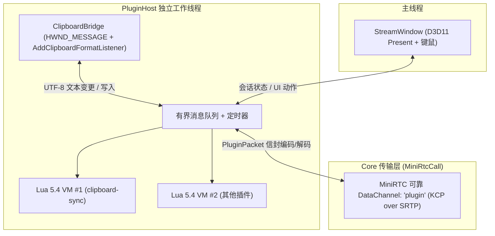

# P2P Remote Lua 插件系统设计方案（v1）

## 1. 设计目标与边界

将 `p2premote` 拆分为 **C++ 实时核心** 与 **Lua 5.4 插件扩展层**：

- **C++ 核心（固定且高实时）**：负责网络建连（信令 / ICE / SRTP）、MiniRTC 媒体与数据通道、DXGI/WGC 采集、硬件 H.264 编解码、D3D11 上屏、低延迟键鼠主通路，以及安全受控的 OS 原语桥接。
- **Lua 5.4 插件层（灵活可扩展）**：负责剪贴板同步、快捷指令/宏、输入法与锁定键辅助、智能画质策略、文件传输等办公工作流与扩展协议。

### 核心约束
1. **零渲染/输入阻塞**：Lua 虚拟机运行在独立插件工作线程，绝不阻塞 `StreamWindow` 主线程的 D3D11 `Present()` 与鼠标采集。
2. **沙箱与权限隔离**：每个插件运行在独立的 `lua_State` 中，按 `plugin.json` 声明授予能力；默认禁止 `io` / `os` / `package` / `debug` / `dofile` / `loadfile`，并启用指令计数看门狗防止死循环卡死插件线程。
3. **单一复用通道**：在 MiniRTC 中只新增 **1 条通用可靠 DataChannel（`"plugin"`）**，所有插件通过统一信封按 `plugin_id` 路由，无需每增一个插件就改传输层协商。

---

## 2. 总体架构与线程模型



### 防回环与隔离机制
- **C++ 层防回环**：`ClipboardBridge` 写入剪贴板后记录 `GetClipboardSequenceNumber()`。进程内的插件会更新文本缓存，并跳过该序号的变更回调。
- **Lua 层去重**：插件记录最近同步内容的 SHA-256 哈希，并在收到相同的本地文本时跳过写入。
- **会话权限**：跨端插件只在已授权桌面控制、双端协商了插件轨道和数据 SRTP 时运行。本地浮层插件在主控端运行，也适用于仅查看会话。
- **路由隔离**：`PluginHost` 强制校验插件只能发送 `plugin_id == 自身 ID` 的消息，收到远端消息时仅投递给对应 `plugin_id` 的插件。

---

## 3. 插件目录与清单规范

插件目录与 `p2premote.exe` 同级（开发与发布统一布局）：

```text
p2premote.exe
p2premote_minirtc.dll
plugins/
  clipboard-sync/
    plugin.json
    main.lua
```

### `plugin.json` 字段说明
```json
{
  "id": "clipboard-sync",
  "name": "剪贴板同步",
  "version": "1.0.0",
  "entry": "main.lua",
  "roles": ["host", "viewer"],
  "enabled": true,
  "permissions": ["channel", "clipboard", "log"]
}
```
- `id`：仅允许 `[a-z0-9_-]`，长度 `1..32`，与所在目录名一致，作为网络路由键。
- `roles`：声明该插件在 `"host"`、`"viewer"` 或两端加载。
- `permissions`：能力白名单，未声明的 `p2p.*` 命名空间不会注入到该插件环境。
- `entry`：插件目录内的 `.lua` 文件名。`enabled` 设为 `true` 时才加载。

---

## 4. 插件通道信封协议（`proto/plugin_protocol`）

遵循现有 `proto/` 零 IO、定长头、可单元测试的设计风格，在 MiniRTC 可靠通道 `"plugin"` 上承载二进制信封：

| 偏移 | 长度 | 字段 | 说明 |
| --- | --- | --- | --- |
| 0 | 1 B | `version` | 协议版本，当前固定为 `1` |
| 1 | 1 B | `plugin_id_len` | 插件 ID 字节长度（`1..32`） |
| 2 | 1 B | `type_len` | 消息类型字节长度（`1..32`，字符规则同插件 ID） |
| 3 | 1 B | `flags` | 标志位（`0` = 完整消息；预留分片/压缩） |
| 4 | 4 B | `payload_len` | 小端无符号 32 位，含头部和标识在内的完整帧最多 64 KiB |
| 8 | 变长 | `plugin_id + type + payload` | 紧凑拼接的路由标识与业务负载 |

---

## 5. Lua Host API（`p2p` 全局表）

沙箱内仅保留安全标准库（`base` 精简版、`table`、`string`、`math`、`utf8`），并注入只读全局表 `p2p`：

插件用局部变量保存状态。每种事件各注册一个回调，重复注册会替换旧回调。每个 Lua VM 有 2 MiB 内存上限、每次调用 20 万指令上限和 32 个定时器槽。模式匹配、`table.move` 和动态脚本加载在 Phase 1 沙箱内禁用。

### Phase 1（MVP 已规划接口）
| 命名空间 | 所需权限 | 接口 | 说明 |
| --- | --- | --- | --- |
| `p2p.session` | 默认开放 | `role()` / `connected()` / `on(event, fn)` | 获取角色（`"host"`/`"viewer"`）、连接态、订阅 `"connected"` / `"disconnected"` |
| `p2p.channel` | `"channel"` | `send(type, payload)` / `on_message(fn)` | 向对端同名插件收发可靠消息（单帧 ≤ 64 KiB） |
| `p2p.clipboard` | `"clipboard"` | `get_text()` / `set_text(text)` / `on_change(fn)` | UTF-8 剪贴板读写与变更事件（内置防回环） |
| `p2p.crypto` | 默认开放 | `sha256(data)` | 供去重与完整性校验使用（基于 Windows CNG / BCrypt） |
| `p2p.timer` | 默认开放 | `after(ms, fn)` / `every(ms, fn)` / `cancel(id)` | 插件线程非阻塞定时器 |
| `p2p.log` | `"log"` | `info(msg)` / `warn(msg)` / `error(msg)` | 统一结构化日志输出 |

### Phase 2（办公插件 API）

| 命名空间 | 权限 | 接口 |
| --- | --- | --- |
| `p2p.ui` | `"ui"` | `add_menu(spec)` 注册主控菜单操作或开关，返回菜单 ID。`set_checked(id, value)` 更新本插件的开关。`notify(text)` 在连接状态区短暂显示提示。 |
| `p2p.input` | `"input"` | 主控用 `send_keys({"Ctrl", "Shift", "Esc"})` 或 `send_text(text)` 向被控端提交输入（`Win+L` 由被控端调用 `LockWorkStation()` 执行）。`get_state()` 返回本机 `caps_lock`、`num_lock` 和可用时的 `ime_open`；`on_state_change(fn)` 在主控锁定键切换时立即触发。被控端用 `set_lock(key, value)` 和 `set_ime(open)` 调整本机状态。`use_lock_sync(enabled)` 让插件接管主控窗口中的锁定键同步。 |
| `p2p.config` | `"config"` | `get(key [, default])` 读取设置，`set(key, value)` 保存布尔值、有限数值或字符串，传 `nil` 删除。键名沿用插件 ID 的字符和长度规则。 |
| `p2p.session` | 默认开放 | `stats()` 返回 `route`（`lan` / `direct` / `relay` / `unknown`）、可用时的 `rtt_ms`、`loss`（0–1）和 `download_bps`。 |
| `p2p.video` | `"video"` | `set_bitrate(preset)` 提交 `economy`、`automatic` 或 `detail`，在主控选中「自动」画质时生效。 |

输入和菜单回调经有界队列跨线程传递。组合键最多 8 个键，文本最多 256 个 UTF-16 代码单元。两端在加密插件通道中确认批量输入能力，再通过可靠控制通道发送输入。Windows 前台应用和输入法决定实际可用的状态及注入行为。

#### Qt 菜单位置

```lua
local id = p2p.ui.add_menu({
    menu = "input",
    path = {"快捷键", "常用"},
    section = "macros",
    order = 20,
    label = "打开任务管理器",
    on_click = function() p2p.input.send_keys({"Ctrl", "Shift", "Esc"}) end
})
```

- 必填字段为 `menu`、`label`、`on_click`。内置菜单 ID 为 `display`（画面）、`audio`（音频）、`input`（输入）、`tools`（工具）、`actions`（菜单）。自定义 ID 须提供 `menu_title`。相同 ID 合并，按 `menu_order`、插件 ID 和注册顺序选择标题及位置。
- `path` 是最多三层的子菜单标题数组。`section` 将同级命令分组，`order` 控制显示顺序。`display` 的 `resolution`、`bitrate` 和 `overlays` 分别对应分辨率、码率和画面浮层。
- `checked` 为布尔值时创建可勾选命令。默认用 `presentation = "item"`。声明 `presentation = "button"` 可作为顶栏直达按钮，此时省略 `path`。自定义菜单和直达按钮共占两个额外位置，剩余项目进入「更多」。
- `menu`、`section` 使用插件 ID 的字符规则，`more`、`plugins` 为保留菜单 ID。顺序权重默认 50，有效范围为 -10000 到 10000。

#### Qt 设置页位置

插件在 `plugin.json` 中声明 `settings` 字段及对应的 `settings_ui`。

```json
"settings_ui": {
  "mode": "page",
  "page": "input",
  "page_title": "输入与控制",
  "nav_group": "软件设置",
  "section": "快捷输入",
  "order": 40
}
```

- `mode: "embed"` 将卡片加入 `appearance`、`general` 或 `stream-audio`。
- `mode: "page"` 创建功能页，需填写自定义 `page` ID 和 `page_title`。相同 ID 的卡片共用一页，按 `order` 排序。首张卡片确定页面的标题和导航分组。导航默认归入「软件设置」，也可指定「插件与扩展」。`section` 省略时使用插件名称。
- 「插件总览」的「前往配置」可定位到对应卡片。字段支持 `bool`、`string`、`int`、`number` 和 `select`。
- `settings_ui.role` 取 `viewer`（默认）或 `host`，与清单中的角色对应。配置写入 `%LOCALAPPDATA%\P2PRemote\plugin-config\<id>.viewer.json` 或 `<id>.host.json`。每份 JSON 上限 16 KiB。
- `ai-agent` 被控插件声明 `sys` 权限后，可用 `p2p.sys.begin_info()` 创建一条本机诊断审批，再用 `p2p.sys.poll_info(id)` 读取结果。内置插件在纯数据会话中可为这两个函数的最后一个参数传入 `true`，请求一次须经单独授权的 PNG 截图。本机授权开关开启、审批获准且审计成功时才返回结果。主控端停止共享时可用 `p2p.sys.cancel_info(id)` 取消尚未返回的请求。
- 主控插件可在清单中用 `agent_reports` 注册 MCP 只读报告，从已审批的系统摘要选取指定字段。清单格式见 [AI Agent 使用说明](ai-agent-design.md)。
- 插件界面的 `save_json` 控件接收 `value` 对象。用户点击按钮并选定本地路径后，Qt 导出 JSON（上限 4 KiB）。

### Phase 3（后续增量扩展）

在主控插件清单中声明 `"roles": ["viewer"]` 和 `"permissions": ["overlay"]` 即可使用浮层 API。可选的 `overlay` 对象接受 `anchor`、`priority`、`default_visible`。锚点为 `top-left`、`top-center`、`top-right`、`bottom-left`、`bottom-center`、`bottom-right`。优先级数值越小，越先靠画面边缘排放。

```lua
p2p.overlay.set_text("连接状态") -- 本插件的 default slot
p2p.overlay.set("clock", {text = "00:01:24.5", anchor = "top-right",
    priority = 10, font_size = 12, opacity = 190, monospace = true,
    text_color = "#ffffff", bg_color = "#27292d", visible = true})
p2p.overlay.clear("clock") -- 省略参数时清除本插件的所有 slot
```

每插件最多 4 个 slot，每会话最多 16 个，单条 UTF-8 文本最多 1024 字节。`set` 和 `set_text` 返回是否接受更新。传入空文本或 `visible=false` 会隐藏当前 slot。脚本可以通过 `p2p.session.stats()` 读取本地视频和网络指标。带 `config` 权限时，主控浮层使用设置中心写入的插件配置。带 `channel` 权限的浮层插件走正常的跨端授权和通道，与本地浮层共享同一会话容量。

- **`p2p.fs`（`"fs"`）**：受限下载目录流式读写 + 拖放事件（支撑文件传输插件）。
- **`p2p.clipboard` 图片扩展**：支持 `CF_DIB` / PNG 截图同步与自动分片。

---

## 6. 首个官方参考插件：`clipboard-sync`

核心逻辑位于 `plugins/clipboard-sync/main.lua`：
- 监听 `p2p.clipboard.on_change`，对非空且 ≤ 60 KiB 的 UTF-8 文本计算 `sha256`，与上次哈希不同且会话已连接时通过 `p2p.channel.send("text", text)` 发送。
- 监听 `p2p.channel.on_message`，收到 `"text"` 且哈希不同于本地最新值时记录哈希并调用 `p2p.clipboard.set_text(payload)`。
- 监听 `p2p.session.on("connected")`，主控端确认被控端也启用了剪贴板插件后，同步当前剪贴板文本。

---

## 7. 分阶段落地路线

1. **Phase 1（MVP 底座 + 剪贴板双向同步）**
   - 引入 Lua 5.4.9（`cmake/lua-target.cmake`，通过 `FetchContent` 和 SHA-256 校验，静态编译）。
   - 新增 `proto/plugin_protocol.*` 与单元测试 `plugin_protocol_test`。
   - 在 `MiniRtcCall` / `StreamSession` 增加 `"plugin"` 可靠 DataChannel 与事件转发。
   - 实现 `ClipboardBridge` 与 `PluginHost`（独立线程、沙箱、看门狗、权限控制）及单元测试 `plugin_host_test`。
   - 内置 `plugins/clipboard-sync/` 并在构建时自动同步到输出目录，双机实测双向复制粘贴。
2. **Phase 2（UI + 输入扩展）**
   - `shortcut-macros` 提供远端切换窗口、任务管理器、锁屏和文本模板。
   - `keyboard-sync` 可从主控向被控同步 Caps Lock、Num Lock 和当前输入法的开关状态。
   - `adaptive-quality` 根据线路、RTT 和丢包选择码率档位，保留手动画质选择和当前分辨率。
3. **Phase 3（文件传输 + 图片剪贴板）**
   - 接入 `p2p.fs` 与分片传输，落地拖拽传文件与截图同步插件。
