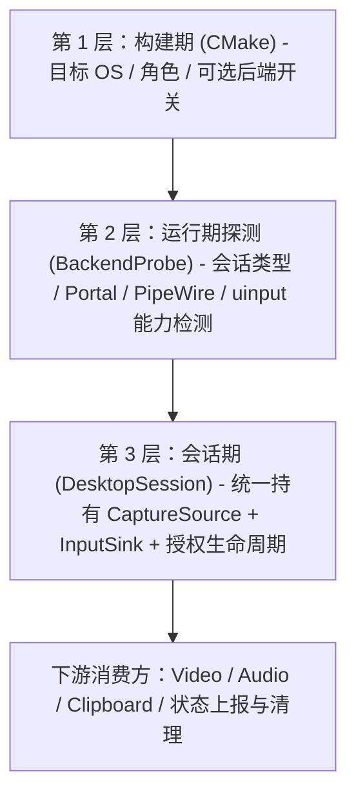
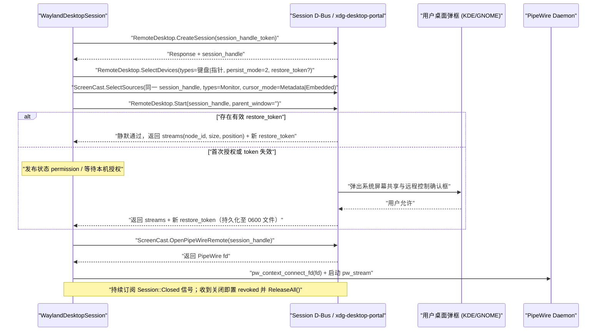

# 系统抽象层重构与 Linux Wayland 被控设计方案

> 状态：设计评审稿（尚未改动业务代码）  
> 目标：在不破坏现有 Windows 与 Linux X11 主/被控能力的前提下，通过分阶段重构抽离系统能力抽象层，并以 **Linux Wayland 被控（`xdg-desktop-portal` + PipeWire）** 作为首个新平台后端完成端到端闭环验证，同时为后续跨平台收敛与新系统接入打下统一基础。

---

## 1. 背景、目标与边界

### 1.1 背景

当前仓库已经具备较完整的 Windows（`core/src/` + `viewer/qt/`）与 Linux（`host/linux/` + `viewer/linux/` + `viewer/qt/`）双端能力，但两者在演进过程中分别形成了各自的实现路径：

1. **Linux 被控端（`host/linux/`）与 X11 / root / VT 深度耦合**：从进程启动入口、画面采集、输入注入，到音频、剪贴板和服务托管，均以“root systemd 守护进程跟踪当前活动 VT 上的 Xorg 会话 + `/dev/uinput` 注入”为唯一前提。
2. **Qt 前端与核心引擎存在平台分裂**：Windows 走 `core/include/p2premote/core_api.h`（C ABI + `wchar_t*` + Win32 `HWND`/`HANDLE`），Linux 客户端走 `viewer/linux/` 直接嵌入，导致主控重连、信令握手、画质码率协商、Qt 面板逻辑在多处双份维护。

如果直接把 Wayland 采集和 Portal 输入“硬塞”进现有的 `X11ShmCapturer` / `LinuxHostSession` / root systemd 服务框架中，不仅会在启动期因为缺少 `/dev/uinput` 权限或 `DISPLAY` 而报错退出，还会迅速制造出第三套割裂实现。因此需要**先理清系统抽象层与运行形态边界，再以明确、可回退的阶段逐步重构并交付 Linux Wayland 被控**。

### 1.2 核心目标

1. **建立三层系统抽象模型**：区分「构建期后端开关」「运行期能力探测与回退」「会话期授权与资源生命周期」，使平台差异收敛到适配器边界内。
2. **明确可渐进落地的 6 阶段重构路线图**：每个阶段都能独立编译、独立运行单元测试与回归测试、支持随时止步或回退，避免大爆炸式重写。
3. **交付 Linux Wayland 被控 MVP（Phase 3）**：基于 `xdg-desktop-portal`（`RemoteDesktop` + `ScreenCast` 联合会话）与 PipeWire（`libpipewire-0.3`），免 root 在 KDE Plasma Wayland 与 GNOME Wayland 用户会话中稳定运行 LAN 与云端被控。
4. **保持既有协议与体验 100% 兼容**：不改动云端 `/api/v2` 接口、WebSocket 信令协议、LAN 配对与 MiniRTC 媒体/数据通道线缆格式，现有 Windows 与 Linux 主控端无需改动即可控制新增的 Wayland 被控端。

### 1.3 明确非目标（Out of Scope for First Wave）

以下能力**不纳入本次重构首波交付**，避免阶段范围蔓延：

- **不重写 Windows `core/src/` 内核**：保留现有 DXGI / WGC 采集与 Media Foundation 硬编解码链路，仅在后期（Phase 5–6）抽离可共享的纯 C++ 业务逻辑并平滑演进 C ABI。
- **不支持 Wayland 登录前界面（GDM/SDDM Greeter）与锁屏态无人值守**：这是 Wayland Compositor 与 Portal 的安全边界所决定的，不在被控端绕过合成器权限模型（Phase 4 会在 UI 中清晰告知用户当前运行态边界）。
- **Phase 3 MVP 不强求 DMA-BUF GPU 零拷贝硬编**：接口层为原生 GPU/DMA-BUF 句柄预留扩展位，首版 PipeWire 采集使用 `SPA_DATA_MemFd` / `SPA_DATA_MemPtr` + `NV12`/`BGRx` 交付稳定帧流，待功能闭环后再做 GPU 零拷贝专项优化。
- **本次仅产出架构与分步重构设计文档**：在评审确认具体阶段边界前，不修改任何业务源码。

---

## 2. 现有代码架构盘点与核心痛点

### 2.1 Linux Host（`host/linux/`）内部的 5 处硬耦合

通过逐文件核对当前实现，阻塞 Wayland 被控的根耦合集中在以下 5 个点：

| 痛点 | 精确代码位置 | 现状说明 | 对 Wayland / 新后端的阻塞 |
| --- | --- | --- | --- |
| **1. 采集实现与 CMake 依赖硬编码** | `host/linux/main.cpp:141`<br>`host/linux/cloud_host.cpp:206`<br>`cmake/linux-host.cmake:4` | LAN 与 Cloud 入口均直接 `std::make_unique<X11ShmCapturer>()`；CMake 无条件要求 `xcb xcb-shm xcb-xfixes xau`。 | 无法按会话类型或构建选项动态选择 `WaylandDesktopSession` / `X11DesktopSession`，也无法纯 Wayland 构建。 |
| **2. 输入注入强绑定 `/dev/uinput`** | `host/linux/host_session.h:79`<br>`host/linux/host_session.cpp:70-73` | `LinuxHostSession` 直接持有具体类型成员 `UinputInjector injector_`，构造时若 `!injector_.Valid()` 直接失败返回，使 `Valid()` 为 `false`。 | 普通用户的 Wayland 会话默认没有 `/dev/uinput` 写权限，且 Wayland 正规输入路径是 Portal `RemoteDesktop`。 |
| **3. VT 号作为桌面唯一标识泄漏至 4 个子系统** | `host/linux/capture_backend.h:39-40`<br>`host/linux/host_session.cpp:195,308,359,367-378,414,470`<br>`host/linux/desktop_audio.h:11-16`<br>`host/linux/desktop_audio.cpp:52-64`<br>`host/linux/clipboard_endpoint.cpp:37,42`<br>`host/linux/clipboard_relay.h`<br>`host/linux/clipboard_agent.cpp:20-44` | `LinuxCaptureBackend::ActiveFrameVt()` 决定输入是否放行（`InputAvailable() { return ActiveFrameVt() != 0; }`）、音频是否允许采集（`DesktopAudioState{revision, vt}` 且 `IsUserDesktop()` 硬编码 `type == "x11"`）、剪贴板是否连接（`ActiveClipboardDesktop()` 检查 `type == "x11"` 且 `vt != 0`、`OwnDesktop()` 检查 `DISPLAY`）。 | Wayland 用户会话虽然可能有 logind session，但被控端本身运行在用户态并直接受 Portal 授权状态（而非 VT 号变化）约束；用 `vt == 0` 表示“未就绪”会把所有下游子系统一并锁死。 |
| **4. 同步轮询拉帧与异步推帧架构冲突** | `host/linux/host_session.cpp:387-510`<br>`host/linux/capture_backend.h:10-15` | `CaptureLoop` 按固定周期轮询 `GrabFrame()`，且强制假设输出为连续内存 `bgra`，无条件执行 `libyuv::ARGBScale` + `ARGBToNV12` 并 `sleep_for` 等待下一周期。 | PipeWire `pw_stream`、Windows `IVideoCapturer::ReadyEvent()`（`core/src/dxgi_capturer.h:39`）、macOS ScreenCaptureKit 均为回调/事件驱动推帧，且 PipeWire 原生可直接协商出 `NV12`。 |
| **5. root systemd 托管模型与用户会话冲突** | `host/linux/p2premote-host.service.in`<br>`host/linux/p2premote-cloud-host.service.in`<br>`host/linux/service_support.cpp`<br>`viewer/linux/service_control.cpp:14-158` | 单元文件硬编码 `User=root`、配置在 `/etc/p2premote/*`、管理动作通过 `pkexec` 提权、客户端状态文本直接写死 `"已连接，正在等待活动的 Xorg 桌面"`。 | `xdg-desktop-portal` 严格绑定到当前登录用户的 session D-Bus 与 `XDG_RUNTIME_DIR`，root 进程既拿不到用户的交互授权弹窗，也无法长期持有用户的 PipeWire 句柄。 |

### 2.2 跨平台与 Qt 前端收敛缺口

除 Linux Host 外，现有主控端与跨平台公共边界还存在三类历史债务（将在 Phase 4–6 分步清理，**不阻塞 Phase 1–3 的 Wayland 被控交付**）：

1. **Qt 窗口直接承载平台判断**：
   - `viewer/qt/remote_window.cpp` 中包含 10 处 `#if defined(Q_OS_WIN)` / `#if !defined(Q_OS_WIN)` 条件编译，直接处理底层渲染窗口与事件差异；
   - `viewer/qt/account_window.cpp` 中包含 30 余处 `#if defined(Q_OS_WIN)` / `#if defined(Q_OS_LINUX)` 分支，将 Windows 服务控制和 Linux 服务控制细节直接混入页面组件。
2. **核心 C ABI 存在 Windows 语义泄漏**：
   - `core/include/p2premote/core_api.h` 大量使用 `const wchar_t*`（Windows UTF-16 语义）、`void* video_parent`（实为 Win32 `HWND` 或 `HMONITOR`）以及 `p2p_stream_wait_handle()` 返回的 Win32 `HANDLE`。
3. **跨平台公共会话逻辑存在双份维护**：
   - 近期修复的云端重连与断线恢复逻辑，需同步改动 Windows `core/src/stream_session.cpp` 与 Linux `viewer/linux/viewer_session.cpp` / `host/linux/cloud_host.cpp`，说明重连策略、信令/LAN HMAC 状态机、输入状态防卡键及画质码率协商尚未抽离为平台无关纯 C++ 模块。

---

## 3. 目标系统层架构设计

### 3.1 三层决策模型

系统平台层的全部选择遵循 **「构建期裁剪 → 运行期探测 → 会话期闭环」** 三层模型，职责严格单向传递，不在运行时用零散 `#ifdef` 或业务猜测兜底：



1. **第 1 层（构建期）**：决定编译进二进制的后端集合。例如 Linux Host 通过 `P2PREMOTE_LINUX_HOST_X11` 与 `P2PREMOTE_LINUX_HOST_WAYLAND` 开关独立编译，允许精简容器或特定发行版只编译其中之一。
2. **第 2 层（运行期能力探测）**：在进程启动与建立工厂前，探测当前会话上下文：
   - 会话环境变量与 logind 类型：`XDG_SESSION_TYPE`、`WAYLAND_DISPLAY`、`DISPLAY`、`XDG_CURRENT_DESKTOP`；
   - Wayland 能力：会话 D-Bus 是否在线、`org.freedesktop.portal.Desktop` 是否提供 `ScreenCast` 与 `RemoteDesktop`、PipeWire 守护进程是否可达；
   - X11 / 特权能力：当前是否以 root 运行或具备 `/dev/uinput` 写权限、活动 VT Xorg 是否可达；
   - 支持命令行 `--backend=auto|wayland|x11` 与 `--probe` 诊断输出，探测失败给出结构化原因而非模糊报错。
3. **第 3 层（会话期统一契约）**：由单一 `DesktopSession` 协同管理「采集 + 输入 + 当前桌面身份 + 授权状态」。只要桌面失活、锁屏或用户撤销了共享授权，`DesktopSession` 统一将状态置为 `waiting_desktop` / `revoked`，同步驱动发送线程停流、输入层 `ReleaseAll()`，以及音频与剪贴板摘除旧会话绑定。

### 3.2 六大系统能力抽象边界

围绕当前仓库已有的 `PtySession`（`core/src/pty_session.h` + `core/src/pty_session_posix.cpp`）、`Credentials`（`viewer/qt/credentials.h`）等成熟模式，将系统差异归口到 6 个能力接口：

| 抽象能力 | 职责边界 | Windows 映射 | Linux X11 映射 | Linux Wayland 映射 | 未来 macOS / 移动端 |
| --- | --- | --- | --- | --- | --- |
| **`DesktopSession`**<br>（含 `CaptureSource` + `InputSink` + `DesktopTarget`） | 桌面采集、光标获取、绝对/相对输入注入、授权状态与桌面目标标识 | `IVideoCapturer`（DXGI / WGC）+ `SendInput` | `X11ShmCapturer`（Xorg VT 追踪）+ `UinputInjector` | `PipeWireCaptureSource` + `PortalInputSink`（`RemoteDesktop`+`ScreenCast`） | ScreenCaptureKit + `CGEvent`（macOS） |
| **`VideoSurfaceAdapter`** | Qt 远控窗口画面绑定、缩放与帧提交（Phase 5 收敛） | `HWND` 子窗口 + D3D11/DXGI 交换链 | `VideoSurface`（`QOpenGLWidget` / 软件/GL 渲染） | 与 Linux Viewer 共用 Qt Wayland / GL 渲染表面 | Metal / CAMetalLayer |
| **`AudioBackend`** | 桌面音频回环采集与播放，随 `DesktopTarget` 生命周期切流或停止 | WASAPI loopback (`core/src/audio_engine.*`) | 提权切至目标 `uid` 后连接 `pulse/native` | 直接在用户态连接 `unix:$XDG_RUNTIME_DIR/pulse/native`（`pipewire-pulse`） | CoreAudio Process Tap |
| **`ClipboardBridge`** | 文本与文件拖拽剪贴板代理，按 `DesktopTarget` 与合成器能力分级启用 | Win32 剪贴板 + `clipboard_bridge.*` | `p2premote_clipboard`（X11 Selection + FUSE3） | Data-control 协议代理（KDE 原生支持；不支持时显式能力降级） | NSPasteboard |
| **`HostServiceAdapter`** | 被控服务安装、启停、自启、状态查询与日志指引（Phase 4 收敛） | Windows Service (`p2premote_service.exe`) + 命名管道 | systemd 系统服务 (`p2premote-host.service`, root + `pkexec`) | `systemctl --user`（`p2premote-user-host.service`，免 `pkexec`）或前台托管 | launchd User Agent |
| **`SecretStore`** | 账号密码、LAN 访问码及 Wayland Portal `restore_token` 安全存储 | Windows Credential Manager (`viewer/qt/credentials.cpp`) | Linux Secret/配置存储（`viewer/linux/credentials.cpp` + `/etc/p2premote`） | 用户配置 `~/.config/p2premote/`（`0600`）或 libsecret/Keyring | macOS Keychain |

### 3.3 核心 C++20 接口契约设计（轻量演进，供 Phase 1–2 直接落地）

接口设计遵循一条硬原则：**抽象厚度刚好够用，优先服务 `host/linux/` 的实际重构，不提前套用沉重框架**。

#### (1) `DesktopTarget`：用结构化目标身份取代裸 `unsigned vt`

```cpp
enum class DisplayServer {
    unknown,
    x11,
    wayland,
    win32,
    macos,
};

struct DesktopTarget {
    DisplayServer server{DisplayServer::unknown};
    std::uint32_t uid{};         // 登录用户 UID（0 表示未绑定具体用户桌面）
    std::string session_id;      // logind / 系统会话 ID（如 "2"）
    unsigned vt{};               // X11 下为真实 VT；Wayland 用户会话可为 0
    std::string runtime_dir;     // 用户态音频/Portal socket 根目录（如 /run/user/1000）
    std::uint64_t epoch{};       // 目标会话或 Portal 流代次，每次重建/重授权递增
    bool unlocked{false};        // 桌面未锁屏且当前允许采集/交互

    bool valid() const noexcept {
        return server != DisplayServer::unknown && epoch != 0 && unlocked;
    }
    bool operator==(const DesktopTarget&) const = default;
};
```

- **解决什么问题**：音频与剪贴板不再问“VT 是几，以及它是不是 x11”，而是订阅 `DesktopTarget` 变化。`epoch` 或 `session_id` / `uid` / `unlocked` 一旦变化，下游立刻安全重建或停流。

#### (2) `InputSink`：可插拔输入注入接口

```cpp
class InputSink {
public:
    virtual ~InputSink() = default;

    virtual bool IsAvailable() const noexcept = 0;
    virtual void WakeDisplay() noexcept = 0;
    virtual void Apply(const InputPacket& packet) noexcept = 0;
    virtual void ApplyCommand(const InputCommand& command) noexcept = 0;
    virtual void ReleaseAll() noexcept = 0;
    virtual std::string Describe() const = 0;
};
```

- **Phase 1 实现**：`UinputInjector` 实现 `InputSink`，`LinuxHostSession` 通过 `std::unique_ptr<InputSink>` 持有，彻底移除构造期因无法打开 `/dev/uinput` 而直接失败的限制。
- **Phase 3 实现**：`PortalInputSink` 实现 `InputSink`，内部保存 `pressed_keys_` 与 `pressed_buttons_` 集合，保证断连/失权时 `ReleaseAll()` 行为与 `UinputInjector` 完全一致。

#### (3) `VideoFrameView` 与 `DesktopSession`：事件驱动帧通知与多格式支持

```cpp
enum class VideoPixelFormat {
    bgra32,
    bgrx32,
    nv12,
};

struct VideoFrameView {
    int width{};
    int height{};
    VideoPixelFormat format{VideoPixelFormat::bgra32};
    const std::uint8_t* plane0{};
    int stride0{};
    const std::uint8_t* plane1{}; // NV12 UV 平面，BGRA/BGRx 为 nullptr
    int stride1{};
    std::uint64_t sequence{};     // 每次实际捕获/推送递增，辅助静帧去重
    std::int64_t capture_ts_us{}; // 采集时间戳（微秒）
    // 未来扩展位：Phase 3+ 可增加可选 DMA-BUF fd / modifier，MVP 阶段不启用
};

enum class DesktopSessionState {
    idle,
    waiting_permission, // Wayland Portal 授权确认中
    waiting_desktop,    // X11 VT 切换中 / Wayland 会话锁定
    ready,              // 可采集且可输入（允许具体子能力按能力标志降级）
    revoked,            // 用户手动点击停止共享或会话被合成器关闭
    error,
};

struct DesktopCapabilities {
    bool capture_video{false};
    bool inject_input{false};
    bool embedded_cursor_only{false};
    bool clipboard_control{false};
};

class DesktopSession {
public:
    virtual ~DesktopSession() = default;

    virtual bool Start() = 0;
    virtual void Stop() = 0;

    // 阻塞等待下一帧就绪或状态变化，超时返回 false（兼容 X11 轮询适配器与 PipeWire 事件唤醒）
    virtual bool WaitForActivity(std::chrono::milliseconds timeout) = 0;
    virtual std::optional<VideoFrameView> AcquireLatestFrame() = 0;
    virtual std::optional<CursorUpdate> PollCursor(bool force) = 0;
    virtual void MarkFrameSent() noexcept = 0;

    virtual DesktopSessionState State() const = 0;
    virtual DesktopTarget Target() const = 0;
    virtual DesktopCapabilities Capabilities() const = 0;
    virtual InputSink& Input() = 0;
    virtual std::string Describe() const = 0;
};
```

- **为何保留 `WaitForActivity` + `AcquireLatestFrame` 而不是只推裸指针回掉**：既能让 PipeWire 在 `on_process` 回调更新最新帧槽位后通过 `condition_variable` **零延迟唤醒** 发送线程（无额外轮询功耗，也避免在 PipeWire 实时线程执行编码/缩放），又能无缝适配 X11 的 `XShmGetImage` 定时抓屏模型。

---

## 4. Linux Wayland 被控专项设计

### 4.1 运行形态界定：用户态会话 vs 系统级 root 服务

在 Linux 桌面上，X11 与 Wayland 的权限模型存在根本差异，设计上明确区分两种运行形态而不是强迫 Wayland 伪装成 root daemon：

| 维度 | X11 无人值守模式（保留并重构接口） | Wayland 被控模式（Phase 3–4 新增） |
| --- | --- | --- |
| **运行身份与单元** | root 系统服务 `p2premote-host.service` | 当前登录用户态运行（CLI 前台 / App 托管 / `systemd --user` `p2premote-user-host.service`） |
| **桌面会话访问方式** | 通过 `/sys/class/tty/tty0/active` + `/proc` 嗅探并连接任意 VT Xorg | 直接继承用户 `DBUS_SESSION_BUS_ADDRESS` 与 `XDG_RUNTIME_DIR`，调用 `org.freedesktop.portal.Desktop` |
| **输入注入路径** | `/dev/uinput`（需要 root 或 `uinput` 组权限） | Portal `RemoteDesktop` D-Bus 方法（免 root）；若显式有 `/dev/uinput` 权限也可作可配置备选 |
| **锁屏 / GDM 登录前** | 支持（Xorg rootless / greeter 下可达） | **不支持**（合成器安全限制，锁屏期间状态切为 `waiting_desktop` 并停止推流与注入） |
| **持久化重启恢复** | 自动重连即用 | 使用 `persist_mode=2` + `restore_token` 实现**同用户已登录会话内免弹窗自动恢复**（视桌面环境支持情况而定） |

> 双方共用同一份 LAN / Cloud 信令、MiniRTC 传输与 `LinuxHostSession` 状态机，但监听端口与实例互斥：当用户在 Wayland 会话启用本机被控时，前端托管层优先调度用户态实例，避免与 root 系统服务争抢 `27887` 端口或相同 `device_id`。

### 4.2 `xdg-desktop-portal` 联合会话建链与状态机

`cmake/linux-host.cmake:5` 已无条件链接 `libsystemd`（本机验证版本为 `262`，`host/linux/clipboard_endpoint.cpp` 已直接在使用 `sd-bus`）。因此 **Wayland Portal D-Bus 客户端优先采用 `<systemd/sd-bus.h>` 实现**，不把 `Qt6::DBus` 绑死进后台渲染/媒体线程，保持极低依赖体积。



关键边界细节：
1. **联合会话顺序强制校验**：`ScreenCast.SelectSources` 必须复用 `RemoteDesktop.CreateSession` 创建出来的 `session_handle`，并由 **`RemoteDesktop.Start`（而非 `ScreenCast.Start`）统一触发授权与启动**，这样才能在同一个共享会话上同时合法获取画面流和远控输入权。
2. **异步 `Request::Response` 处理**：`xdg-desktop-portal` 所有异步接口都会在 `handle_token` 对应对象路径上发回 `org.freedesktop.portal.Request::Response(uint32 response, vardict results)` 信号。客户端必须在调用方法**之前**先 `sd_bus_add_match` 订阅响应路径，避免竞争窗口丢信号。
3. **`restore_token` 持久化与降级**：
   - 存放路径：`~/.config/p2premote/wayland-portal.token`（权限严格设为 `0600`，后续通过 `SecretStore` 统一治理）；
   - `persist_mode = 2`（Persistent until revoked）；若用户撤销权限或桌面忽略无效 token 导致 `Start` 返回非 0 错误码，自动清理本地失效 token，将状态转为 `waiting_permission` / `revoked` 并通知用户重新授权。
4. **`Session::Closed` 实时监听**：用户随时可能点击 GNOME 顶栏或 KDE 系统托盘的“停止共享”按钮，一旦收到 `Session::Closed` 信号，`WaylandDesktopSession` 立即：
   - 将状态改为 `revoked`（触发 `LinuxHostSession` 清空发送队列并通知主控状态变化）；
   - 调用 `PortalInputSink::ReleaseAll()` 释放全部已按下键鼠；
   - 安全停止 PipeWire 流并释放 `fd`。

### 4.3 PipeWire 采集管线（`PipeWireCaptureSource`）

本机环境已预装 `libpipewire-0.3 1.6.11`，采集管线设计如下：

1. **线程模型**：在 `PipeWireCaptureSource` 内创建独立 `pw_thread_loop`，通过 `pw_context_connect_fd(portal_fd)` 接入 Portal 授权的隔离 PipeWire 句柄（而非全局无授权 socket），使用 `pw_stream` 连接 `streams[0].node_id`。
2. **格式协商（MVP 首选 CPU 内存路径）**：
   - 在 `SPA_PARAM_EnumFormat` 中声明偏好顺序：**`SPA_VIDEO_FORMAT_NV12` > `SPA_VIDEO_FORMAT_BGRx` > `SPA_VIDEO_FORMAT_BGRA`**；
   - 若合成器（如 KWin/Mutter）能直接协商输出 `NV12` 且无需缩放，Phase 2 改造后的 `CaptureLoop` 可**跳过 `libyuv::ARGBToNV12`**，直接将只读平面喂给 MiniRTC 编码器，大幅降低 CPU 占用；
   - 若输出为 `BGRx`/`BGRA`，则走与 X11 相同的 `libyuv::ARGBScale` + `ARGBToNV12` 管线；
   - Buffer 类型协商支持 `SPA_DATA_MemFd` 与 `SPA_DATA_MemPtr`（`MAP_READ`），Phase 3 首版**暂不协商 `SPA_DATA_DmaBuf`**，待零拷贝 VA-API / NVENC 硬编演进时再开启（已在 `VideoFrameView` 中预留演进位）。
3. **实时线程解耦（`LatestFrameSlot`）**：
   - `pw_stream` 的 `on_process` 回调函数运行在 PipeWire 实时音频/视频线程上，**严禁在 `on_process` 中执行网络发送、锁长时间阻塞或整帧重编码**；
   - `on_process` 仅从 `pw_stream_dequeue_buffer` 映射像素并写入双缓冲 `LatestFrameSlot`（含帧序号递增与时间戳），随即将 buffer 归还 `pw_stream_queue_buffer`，再触发条件变量唤醒 `LinuxHostSession::CaptureLoop`；
   - 编码/发送慢于采集时，`LatestFrameSlot` 自然覆盖中间未消费帧，确保队列深度恒为 1，维持最低端到端延迟。
4. **光标与动态分辨率**：
   - `on_param_changed` 中解析最新的 `SPA_VIDEO_INFO_RAW` 宽高与格式，自动刷新 `VideoFrameView` 元数据；
   - `ScreenCast.SelectSources` 优先尝试 `cursor_mode = 4`（Metadata），当桌面支持时在 `spa_buffer` 中读取 `SPA_META_Cursor` + `SPA_META_Bitmap`，通过重构抽出的公共光标编码函数生成 P2P Remote 现有 `'C'` 协议包（`cursor` 数据通道）；若不支持 `4`，自动降级为 `cursor_mode = 2`（Embedded，光标直接合入视频画面）。

### 4.4 Portal 输入注入管线（`PortalInputSink`）

1. **核心 D-Bus 映射**（均作用于同一已启动的 `session_handle`）：
   - **绝对移动（`InputKind::move`）**：调用 `org.freedesktop.portal.RemoteDesktop.NotifyPointerMotionAbsolute(session_handle, options, stream_node_id, x, y)`；
   - **鼠标按键（`left/right/middle_down/up`）**：调用 `NotifyPointerButton(session_handle, options, linux_btn_code, state)`（`BTN_LEFT=0x110`, `BTN_RIGHT=0x111`, `BTN_MIDDLE=0x112`）；
   - **滚轮（`wheel`）**：优先调用离散格数接口 `NotifyPointerAxisDiscrete`（支持高精度缩放/滚动步长），兼容平滑滚动 `NotifyPointerAxis`；
   - **键盘按键（`key_down/up` 与 `InputCommand`）**：复用重构后的 `Ps2ScancodeToLinuxKey()` 与 `WindowsVkToLinuxKey()`，调用 `NotifyKeyboardKeycode(session_handle, options, evdev_keycode, state)`。
2. **HiDPI 逻辑坐标坑点与处理**：
   - `InputPacket` 携带 `[0, 65535]` 归一化坐标，而 `RemoteDesktop.Start` 返回的 `streams` 属性中包含每个流的逻辑尺寸 `size = (logical_w, logical_h)`，**在开启小数缩放（如 125%、150%、200%）时，这个逻辑尺寸可能不同于 PipeWire 视频帧的物理像素尺寸**；
   - 因此 `PortalInputSink` **必须使用 Portal `streams` 元数据返回的逻辑宽高做坐标映射**（若合成器未提供 `size`，再回退使用最新视频帧宽高），并在收到流参数变更或多屏映射变化时同步更新映射目标。
3. **防卡键与安全清理**：
   - 与 `UinputInjector` 相同，`PortalInputSink` 在内部维护 `pressed_keys_` 和 `pressed_buttons_` 集合；
   - 每当发生断连、1500ms 输入租约超时（与 `host_session.cpp:415` 保持一致）、`Session::Closed` 或析构时，调用 `ReleaseAll()` 遍历集合向 Portal 发送释放事件并清空集合。
4. **可配置特权回退**：
   - 当宿主机用户本身处于 `uinput` 组或显式传入 `--input=uinput` 且 `/dev/uinput` 可写时，仍支持将 `PipeWireCaptureSource` 与 `UinputInjector` 组合运行（适用于某些版本较旧、Portal 键盘存在限制的 wlroots/Wayland 合成器）。

### 4.5 音频与剪贴板适配要点

- **桌面音频**：当前 `host/linux/desktop_audio.cpp:52-64` 中 `IsUserDesktop()` 强制要求 `sd_session_get_type == "x11"` 且 `session_vt == vt`。重构为基于 `DesktopTarget` 后：
  - 若宿主机进程已运行在当前用户 UID 下（Wayland 用户态模式），`RunDesktopAudioCapture()` 直接在本用户下运行并连接 `unix:$XDG_RUNTIME_DIR/pulse/native`（无需 `setpriv`）；PipeWire 的 `pipewire-pulse` 兼容层会透明提供完整的 sink monitor，现有 `PulseMonitor` 代码可直接工作！
  - 若宿主机为 root 系统服务（X11 模式），保留原有的 `setpriv` 降权启动子进程路径以维持安全边界。
- **剪贴板与文件剪贴板**：当前 `host/linux/clipboard_endpoint.cpp:37` 与 `host/linux/clipboard_agent.cpp:20-44` 强依赖 `type == "x11"`、`DISPLAY` 与 `vt`：
  - Phase 1 先将通信端点键控从 `vt` 迁移到 `DesktopTarget{session_id, uid, ...}`，保留现有 X11 `p2premote_clipboard` 逻辑不变；
  - Phase 4 在 Wayland 下检测合成器是否支持 `ext-data-control-v1` / `zwlr-data-control-manager-v1`（KDE Plasma 6 / wlroots 已支持后台无窗口剪贴板读写），支持则接通文本/文件剪贴板同步；对于不支持后台 data-control 的合成器（如未开放该扩展的 GNOME Wayland），通过 `DesktopCapabilities::clipboard_control = false` 显式上报“受合成器限制，暂不支持后台剪贴板同步”，避免无限报错或空转。

---

## 5. 分阶段重构路线图

重构拆分为 **6 个边界清晰、递进演进的阶段**。其中 **Phase 1–3** 专注打通 **Linux Wayland 被控端闭环**；**Phase 4** 补齐服务托管、Qt 控制面板与 Wayland 剪贴板；**Phase 5–6** 收敛跨平台渲染与公共业务逻辑重复。

### 5.1 阶段总览矩阵

| 阶段 | 名称与核心目标 | 前置依赖 | 对既有 X11 / Windows 行为的影响 | 主要改动目录 | 里程碑标志 |
| --- | --- | --- | --- | --- | --- |
| **Phase 1** | 解除 Linux Host 内部 X11 / uinput / VT 硬耦合 | 无 | **零行为变化**（纯内部抽象重构） | `host/linux/` | 无真实 X11/uinput 依赖可运行 `LinuxHostSession` Mock 单测 |
| **Phase 2** | 演进为 `DesktopSession` 与事件驱动推帧/多像素格式 | Phase 1 | X11 帧率与低延迟表现持平；新增等待授权状态位 | `host/linux/` | 异步推帧、`NV12` 直通、分辨率热切换单测全绿 |
| **Phase 3** | **实现 Linux Wayland Portal + PipeWire 被控端 MVP** | Phase 2 | **零破坏**，通过 `--backend=wayland|auto` 启用 | `host/linux/`, `cmake/` | KDE & GNOME Wayland 下 LAN/Cloud 画面+键鼠+音频端到端跑通 |
| **Phase 4** | 统一服务托管、`systemctl --user`、Wayland 剪贴板与 UI 状态 | Phase 3 | 保留 X11 root 无人值守逻辑；新增 Wayland 用户态托管 | `host/linux/`, `viewer/linux/`, `viewer/qt/` | Qt「本机」页无缝识别 Wayland/X11 并托管对应服务 |
| **Phase 5** | 收敛 Qt `VideoSurfaceAdapter` 与跨平台公共会话纯逻辑 | Phase 1+（可与 Phase 4 并行） | 消除 Windows/Linux 重复修 bug；用户无感 | `viewer/qt/`, `viewer/linux/`, `core/` | `remote_window.cpp` 移除 `#ifdef` 渲染差异；共用重连/信令/状态机单测 |
| **Phase 6** | 面向 macOS / 移动端演进统一 UTF-8 + 回调 C ABI（远期） | Phase 5 | 兼容旧 ABI 或版本化切换 | `core/include/`, `core/src/`, `viewer/qt/` | 新平台接入不再依赖 `wchar_t*` / Win32 `HANDLE` |

---

### 5.2 Phase 1：解除 Linux Host 内部 X11 / uinput / VT 硬耦合（零行为回归）

#### 目标
把 `LinuxHostSession` 从具体类 `X11ShmCapturer`、`UinputInjector` 和裸概念 `unsigned vt` 中彻底解耦，为后续接入非 X11 后端扫清结构障碍，同时保证现有 X11 无人值守与系统服务行为一字不差。

#### 具体步骤与涉及文件
1. **抽取可插拔输入接口 `InputSink`**：
   - 新增 `host/linux/input_backend.h`，定义抽象基类 `InputSink`；
   - 拆分键码转换函数 `Ps2ScancodeToLinuxKey()` 与 `WindowsVkToLinuxKey()` 到独立工具头/源文件（如 `host/linux/linux_key_map.h/.cpp`），便于后续 `UinputInjector` 与 `PortalInputSink` 共用，**避免仅为了查键码表而链接整个 uinput 实现**；
   - 修改 `host/linux/uinput_injector.h/.cpp`，令 `UinputInjector` 继承 `InputSink`；
   - 修改 `host/linux/host_session.h/.cpp`：将 `UinputInjector injector_` 替换为 `std::unique_ptr<InputSink> injector_`，允许空/不可用时走注入安全门控而不直接阻断进程，若具体构建仍要求 uinput 则由创建侧显式校验。
2. **以 `DesktopTarget` 取代 `ActiveFrameVt()`**：
   - 新增 `host/linux/desktop_target.h`，定义 `DisplayServer` 与 `DesktopTarget`；
   - 修改 `host/linux/capture_backend.h`：`ActiveFrameVt()` 替换为 `virtual DesktopTarget ActiveTarget() const = 0;`（`InputAvailable()` 改为 `ActiveTarget().valid()`）；
   - 修改 `host/linux/x11_shm_capturer.h/.cpp`：构造 `DesktopTarget{DisplayServer::x11, uid, session_id, vt, runtime_dir, epoch, unlocked}` 返回；
   - 修改 `host/linux/desktop_audio.h/.cpp`：`DesktopAudioState` 将 `unsigned vt` 替换为 `DesktopTarget target`；`IsUserDesktop()` 按 `target.server` 分支判断（当 `server == wayland` 或运行 UID 等于目标 UID 时不再要求 `type == "x11"` 与 `vt` 匹配，同时**完整保留 X11 root 模式的 `setpriv` 安全隔离**）；
   - 修改 `host/linux/clipboard_endpoint.h/.cpp`、`host/linux/clipboard_relay.h/.cpp` 与 `host/linux/host_session.cpp`：将 `FrameVt` 回调重构为 `std::function<std::optional<DesktopTarget>()>`。
3. **抽取通用光标封包工具 & 后端工厂**：
   - 将 `host/linux/x11_shm_capturer.h:31` 中的 `EncodeXFixesCursor()` 纯像素转 `'C'` 包函数抽离至平台无关的 `host/linux/cursor_packet.h/.cpp`（`EncodeRgbaCursorPacket(...)`），供 X11 XFixes 与未来 PipeWire `SPA_META_Cursor` 共同复用；
   - 新增 `host/linux/backend_factory.h/.cpp`，支持 `--backend=auto|x11` 与能力探测框架；更新 `host/linux/main.cpp:141` 与 `host/linux/cloud_host.cpp:206`，停止直接 `make_unique<X11ShmCapturer>()`。
4. **补充 Mock 单元测试**：
   - 扩展 `host/linux/linux_host_test.cpp`：新增 `MockCaptureBackend` 与 `MockInputSink`，验证「无 `/dev/uinput` 时会话初始化」「桌面切换 `epoch` 变化触发 `ReleaseAll()`」「音频与剪贴板状态随 `DesktopTarget` 联动切换」。

#### 验收标准与验证命令
- 编译：`cmake --build --preset linux-x64 --parallel`
- 测试：`ctest --preset linux-x64 --output-on-failure`（`linux_host_test`、`linux_clipboard_session_test`、`linux_service_lifecycle_test` 等全绿）
- X11 回归：原有 root systemd LAN & Cloud 连接、首帧显示、鼠标/快捷键、音频与剪贴板、息屏唤醒无任何回归。

#### 本阶段明确不做
- 不引入 PipeWire 或 D-Bus Portal 依赖；
- 不改变 `CaptureLoop` 的抓取调度方式；
- 不改动任何客户端 Qt 源码与服务安装单元文件。

---

### 5.3 Phase 2：演进采集管线为 `DesktopSession` 与事件驱动/多格式框架

#### 目标
解决“同步拉取轮询 + 强制假定 BGRA 全帧复制”的架构瓶颈，使 `LinuxHostSession` 能同时优雅驱动**同步拉取型后端（X11）**与**异步推帧型后端（PipeWire）**，并原生支持 `NV12` 直通和权限状态上报。

#### 具体步骤与涉及文件
1. **引入 `DesktopSession` 与 `VideoFrameView`**：
   - 将 `host/linux/capture_backend.h` 演进为 `host/linux/desktop_session.h`（包含 `VideoPixelFormat`、`VideoFrameView`、`DesktopSessionState`、`DesktopCapabilities`、`DesktopSession`）；
   - 新增可复用的双缓冲槽位 `host/linux/latest_frame_slot.h`（供异步推帧后端使用：支持原子替换最新帧、超时等待及唤醒）。
2. **改造 `LinuxHostSession::CaptureLoop` 与 `VideoFrameCadence`**：
   - 将 `host/linux/host_session.cpp:387-510` 固定 `sleep_for` 轮询改为调用 `session_->WaitForActivity(remaining_interval)` + `session_->AcquireLatestFrame()`；
   - 扩展 `host/linux/video_frame_cadence.h`（或其调用参数）以兼容多像素格式输入：当采集帧本身已是 `VideoPixelFormat::nv12` 且无需缩放时，**直接拷贝/提交至 MiniRTC，跳过 `libyuv::ARGBScale` 与 `ARGBToNV12`**；需要缩放或格式为 `bgra32`/`bgrx32` 时，按目标格式走高效转换；
   - 增加动态分辨率防御：尺寸变化、格式变更时自动重置转换缓冲并刷新 `VideoFrameCadence`。
3. **封装 `X11DesktopSession` 与扩展状态发布**：
   - 新增 `host/linux/x11_desktop_session.h/.cpp` 包装 `X11ShmCapturer` + `UinputInjector` 实现 `DesktopSession`；
   - 扩展 `PublishState` 状态枚举映射（保留 `waiting` / `negotiating` / `display` / `streaming`，新增 `permission` 表示等待本机 Portal 弹窗授权、`revoked` 表示共享已被撤销）。
4. **补充调度与状态机单元测试**：
   - 在 `host/linux/linux_host_test.cpp` 中增加基于 `MockDesktopSession` 的用例：模拟高频异步推帧丢旧帧保持最新帧、`NV12` 直通路径、帧宽高动态变更、`waiting_permission -> ready -> revoked` 时自动 `ReleaseAll()` 与状态广播。

#### 验收标准与验证命令
- `cmake --build --preset linux-x64 --parallel && ctest --preset linux-x64 --output-on-failure` 全绿；
- X11 端到端链路延迟、静态画面 1Hz 保活帧逻辑（`VideoFrameCadence` 900ms 策略）与 `encoder` 表现无退化。

#### 本阶段明确不做
- 暂不接入真实 `libpipewire-0.3` / `sd-bus` Portal 代码；
- 暂不重构 Qt 前端的 `remote_window.cpp` 与 `service_control.cpp`。

---

### 5.4 Phase 3：实现 Linux Wayland Portal + PipeWire 被控端 MVP

#### 目标
完成**首个全新平台后端**端到端闭环，让 `p2premote_linux_host` 能在 KDE Plasma Wayland 与 GNOME Wayland 用户会话下免 root 启动，被现有 Windows / Linux 主控端正常发现、连接、观看画面、键鼠控制与听取声音。

#### 具体步骤与涉及文件
1. **CMake 模块化与可选依赖探测（`cmake/linux-host.cmake`）**：
   - 引入构建选项：
     - `option(P2PREMOTE_LINUX_HOST_X11 "Build X11/XShm capture backend" ON)`
     - `option(P2PREMOTE_LINUX_HOST_WAYLAND "Build Wayland Portal+PipeWire backend" ON)`（或检测 `libpipewire-0.3` 与 `libsystemd` 可用时开启）
   - 若关闭 `P2PREMOTE_LINUX_HOST_X11`，不再强要求 `xcb*`，对应单测目标（`linux_host_test`）按已启用后端条件编译目标源码；
   - 当 `P2PREMOTE_LINUX_HOST_WAYLAND=ON` 时，通过 `pkg_check_modules(LINUX_HOST_PIPEWIRE REQUIRED IMPORTED_TARGET libpipewire-0.3)` 链接 PipeWire，并复用已链接的 `libsystemd` 提供 `sd-bus`。
2. **实现 `WaylandPortalClient`（`host/linux/wayland_portal_client.h/.cpp`）**：
   - 基于 `sd-bus` 异步事件循环完成 `RemoteDesktop.CreateSession` → `RemoteDesktop.SelectDevices` → `ScreenCast.SelectSources` → `RemoteDesktop.Start` → `ScreenCast.OpenPipeWireRemote` 全链路；
   - 解析返回的 `streams`（记录 `node_id`、逻辑宽高 `size`、位置 `position`）及 `restore_token`；
   - 读写 `~/.config/p2premote/wayland-portal.token`（`0600` 权限），处理 token 失效降级与重新拉起授权弹窗；
   - 监听 `org.freedesktop.portal.Session::Closed` 信号并回调上层状态。
3. **实现 `PipeWireCaptureSource`（`host/linux/pipewire_capturer.h/.cpp`）**：
   - 用 Portal 返回的 `fd` 启动 `pw_thread_loop` 与 `pw_stream`；
   - 协商 `NV12` / `BGRx` / `BGRA` 及 `MemFd` / `MemPtr` buffer；
   - 在 `on_param_changed` 中同步更新分辨率与色彩格式；在 `on_process` 中极轻量映射帧内容写入 `LatestFrameSlot` 并通知唤醒；
   - 解析 `SPA_META_Cursor`，复用 `EncodeRgbaCursorPacket` 输出 `'C'` 光标包；若当前桌面不支持元数据光标，自动标记 `embedded_cursor_only = true`。
4. **实现 `PortalInputSink` 与 `WaylandDesktopSession`（`host/linux/portal_input_injector.h/.cpp`、`host/linux/wayland_desktop_session.h/.cpp`）**：
   - 将归一化指针坐标转换为 Portal 流逻辑坐标后调用 `NotifyPointerMotionAbsolute`；
   - 对接鼠标按键、滚轮与键盘按键（调用 `Ps2ScancodeToLinuxKey` / `WindowsVkToLinuxKey` 后发往 `NotifyKeyboardKeycode`）；
   - 维护 `pressed_keys_` / `pressed_buttons_`，完善 `ReleaseAll()` 防卡键；
   - 在 `WaylandDesktopSession` 中聚合三者，向音频子系统输出 `DesktopTarget{DisplayServer::wayland, getuid(), session_id, 0, XDG_RUNTIME_DIR, epoch, unlocked}`。
5. **接入工厂与用户态运行入口（`host/linux/backend_factory.cpp`、`host/linux/main.cpp`、`host/linux/cloud_host.cpp`）**：
   - `--backend=auto` 自动识别策略：优先检查用户桌面会话类型（`XDG_SESSION_TYPE == "wayland"` 或 `WAYLAND_DISPLAY` 非空且在非 root 用户会环境中 -> 选择 `wayland`；否则系统服务/X11 会话 -> 选择 `x11`）；支持 `--backend=wayland|x11` 与 `--probe` 探测命令；
   - 允许非 root 用户直接启动 `p2premote_linux_host --code=......`（LAN 前台被控）或用户态云端配置进行联调验收；
   - 修复音频链路用户在同 UID 下无需 `setpriv` 的直连分支（`host/linux/desktop_audio.cpp`）。
6. **单测与真机验证**：
   - 单测：补充 Portal 响应/stream 元数据解析测试、HiDPI 逻辑坐标映射边界测试、`PortalInputSink` 按键跟踪与 `ReleaseAll()` 幂等测试；
   - 真机端到端验收：在 **KDE Plasma Wayland（本地开发机实测环境）** 与 **GNOME Wayland** 上验证 LAN 与 Cloud 被控。

#### 验收标准与验证命令
- 构建与单测：`cmake --preset linux-x64 && cmake --build --preset linux-x64 --parallel && ctest --preset linux-x64 --output-on-failure`
- 无 X11 独立构建测试（验证解耦彻底性）：`-DP2PREMOTE_LINUX_HOST_X11=OFF -DP2PREMOTE_LINUX_HOST_WAYLAND=ON` 能独立编过目标与非 X11 单测；
- 真机联调清单：首次弹框授权后出图、二次重连 `restore_token` 免弹框恢复、HiDPI 缩放下精准点击、拖拽跨断连不卡鼠标键、快捷键透传、桌面声音回传、手动点托盘“停止共享”后正确进入 `revoked` 状态且不崩溃。

#### 本阶段明确不做
- 暂不做系统托盘自启/客户端内一键启用 `systemd --user`（留给 Phase 4）；
- 暂不做 GNOME/KDE 通用 Wayland 剪贴板写入（留给 Phase 4）；
- 暂不做 DMA-BUF 零拷贝硬编。

---

### 5.5 Phase 4：统一 Linux 服务托管、Wayland 剪贴板与 Qt「本机」面板体验

#### 目标
让普通桌面用户不需要命令行即可在 Qt 客户端「本机」标签页中一键开启 Wayland 被控（无需 `pkexec` 输 root 密码），消除界面上“正在等待活动的 Xorg 桌面”等 X11 专用假定，并补齐支持桌面下的 Wayland 剪贴板。

#### 具体步骤与涉及文件
1. **增加 `systemd --user` 用户服务模式**：
   - 新增 `host/linux/p2premote-user-host.service.in`（`systemd --user` 单元模板，`Restart=on-failure`，继承用户图形环境，无需 `User=root` 与 `/sbin/modprobe uinput`）；
   - 扩展 `host/linux/service_support.h/.cpp` 与 `host/linux/main.cpp`：新增 `--user-service` 及配置读写根目录 `~/.config/p2premote/`（`0600`），保留原有 `/etc/p2premote/` 系统服务逻辑给 X11 无人值守使用；
   - 处理实例互斥与端口冲突检测：开启用户态托管前检查 `p2premote-host.service` 是否已激活占用同一端口，提示平滑切换而不是静默冲突失败。
2. **重构 `HostServiceAdapter`（`viewer/linux/service_control.cpp`、`viewer/qt/service_control.h`、`viewer/qt/account_window.cpp`）**：
   - 由桌面类型感知的 `HostServiceAdapter` 决定调用 `systemctl`（系统服务，X11 无人值守）还是 `systemctl --user`（用户态服务，Wayland）；
   - 映射 `permission` / `revoked` 状态到清晰的中文提示（如“请在系统弹出的屏幕共享窗口中允许控制”“屏幕共享已停止，请重新开启或重新授权”）；
   - 对 Wayland 模式在 UI 层如实禁用或标注“锁屏/登录前无人值守仅支持 X11 会话”，不再误导用户并移除 `"已连接，正在等待活动的 Xorg 桌面"` 硬编码。
3. **Wayland 剪贴板桥接（`host/linux/clipboard_endpoint.cpp`、`clipboard_agent.cpp`、`clipboard_session.cpp`）**：
   - Wayland 用户态会话直接以当前用户的 `DesktopTarget` 建链，不再检查 `DISPLAY` 与 `vt`；
   - 实现 `ext-data-control-v1` / `zwlr-data-control-manager-v1` 适配器（覆盖 KDE Plasma 6 与 wlroots 桌面），当底层返回不支持后台剪贴板控制协议时设置能力降级标记并在客户端给出明确提示。

#### 验收标准与验证命令
- 编译完整 Linux 包（`p2premote_qt` + `p2premote_linux_host` + `p2premote_clipboard`）；
- 验证 AppImage/tarball 安装脚本与 `linux_service_lifecycle_test`；
- 在 Wayland 桌面点击「本机」开启 LAN / 云端接收，不弹出 root 密码框即可成功注册并上线；关闭客户端再重启时根据托管设置正确保持/停止。

---

### 5.6 Phase 5：收敛 Qt 远控视频适配器与跨平台公共会话纯逻辑

#### 目标
解决当前 `viewer/qt/` 与 `core/src/` / `viewer/linux/` 之间“一份逻辑改两遍”的结构性痛点。

#### 具体步骤与涉及文件
1. **抽象 `VideoSurfaceAdapter` 清理 `viewer/qt/remote_window.cpp`**：
   - 将 `remote_window.cpp` 中 10 处散落的 `#if defined(Q_OS_WIN)`（含父子句柄绑定、窗口句柄销毁时序、全屏切屏、FPS 呈现统计接入）统一收敛至 `VideoSurfaceAdapter` 接口下各自平台的 `.cpp` 实现中（`viewer/qt/` 保留纯 UI 与交互壳）。
2. **抽取跨平台纯 C++20 公共会话内核模块（如 `core/common/` 或 `proto/` 旁路纯逻辑库）**：
   - 重连策略机（指数退避、临时错误 vs 致命错误判定、窗口期统计，统一 `core/src/stream_session.cpp` 与 `viewer/linux/viewer_session.cpp` 的双份实现）；
   - LAN/Cloud 信令状态机与 HMAC 鉴权流程辅助；
   - 输入防卡键状态表与拖拽中断恢复策略（统一 Windows 与 Linux 主被控两端的键盘/鼠标按键状态机）；
   - 画质与码率协商状态机（`SetQuality` / `SetBitrate` / `video_settings_reply` 确认重传逻辑）。
   - **重要约束**：此阶段抽取的新模块保持 **零平台 API 依赖（纯 C++20 STL）**，从而能同时链接进 Windows MSVC `core` 与 Linux GCC/Clang `p2premote_qt` / `p2premote_linux_host`，并用跨平台单测全覆盖。

#### 验收标准与验证命令
- Linux 与 Windows 构建均开启并全量通过新增的公共会话状态机单元测试；
- 人工回归：Windows↔Linux 互控、断网重连、拖拽期间焦点丢失/切屏不粘连按键。

---

### 5.7 Phase 6（远期演进）：面向 macOS / 移动端收敛 C ABI

#### 目标
当后续确实要接入 macOS 或移动端控制/被控时，避免再复制一套 Windows 专用的 `p2p_*` 接口，平滑演进 `core/include/p2premote/core_api.h`：

1. **字符编码统一为 UTF-8（`const char*`）**：新增 `core_api_v2` 或逐步将配置/状态字段从 `const wchar_t*` 迁移至 UTF-8，消除 Linux/macOS 上的高频编码转换；
2. **异步通知解耦 Win32 `HANDLE`**：用结构化事件回调 + 线程安全队列或通用 `poll_events()` 取代 `p2p_stream_wait_handle()` 与 `p2p_account_event()` 的裸 Windows 事件句柄；
3. **渲染目标语义解耦 `void* video_parent`**：通过不透明渲染描述符（如平台类型枚举 + Win32 `HWND` / Wayland `wl_surface*` / macOS `NSView*` 或跨平台内存帧回调）取代假定 Win32 窗口句柄的 `P2P_VIDEO_FULLSCREEN_MESSAGE`。

---

## 6. 验证矩阵与测试策略

### 6.1 无界面 CI / 自动化测试清单

| 阶段 | 测试目标 / 命令 | 重点覆盖内容 |
| --- | --- | --- |
| Phase 1 | `linux_host_test`（`ctest --preset linux-x64 -R linux_host_test`） | `MockCaptureBackend` + `MockInputSink` 注入/释放生命周期、`DesktopTarget` 切换与代次变更触发 `ReleaseAll()`、键码映射完备性、光标封包编码 |
| Phase 2 | `linux_host_test` + 调度压测用例 | 异步 `LatestFrameSlot` 覆盖旧帧、阻塞等待超时唤醒、`NV12` 直通 vs `BGRA` 缩放、分辨率动态变更加防护、状态机转换 |
| Phase 3 | `linux_host_test` + 独立 `-DP2PREMOTE_LINUX_HOST_X11=OFF` 构建 | Portal D-Bus `vardict`/stream 解析、HiDPI 逻辑坐标越界钳制、`PortalInputSink` 防卡键、X11 裁剪后全目标可独立编过 |
| Phase 4 | `linux_service_lifecycle_test` + `linux_clipboard_session_test` | 系统服务 vs `--user-service` 配置解析与权限掩码检查（`0600`）、无 X11 `DISPLAY` 条件下音频/剪贴板能力判定 |
| Phase 5 | 跨平台会话核心单测（Linux CTest + Windows CTest） | 重连退避时序、HMAC 挑战响应状态转移、拖拽中掉线按键释放序列、画质协商重试 |

### 6.2 真机人工验收矩阵（Phase 3–4 重点）

| 测试场景 | KDE Plasma Wayland | GNOME Wayland | Linux X11 (回归) | Windows↔Linux 双向 |
| --- | --- | --- | --- | --- |
| LAN 与云端发起被控连接 | 必测（首次弹框 + 二次 `restore_token` 免弹窗） | 必测 | 必测（无人值守） | 必测（Windows 控 Wayland + Wayland 控 Windows） |
| 100% / 150% / 200% 小数缩放下点击与拖拽 | 必测（核对逻辑坐标与 PipeWire 物理尺寸不一致时不偏移） | 必测 | 选测 | 必测 |
| 常见组合键（Ctrl+C/V、Alt+Tab、Meta、中文输入切换上下文） | 必测 | 必测 | 必测 | 必测 |
| 手动在系统托盘/顶栏点击“停止共享” | 必测（立即置 `revoked`、释放已按按键、无崩溃） | 必测 | — | — |
| 锁屏后状态切换与解锁恢复 | 必测（提示不可控状态，不卡死发送线程） | 必测 | 必测 | — |
| `pipewire-pulse` 桌面音频同步 | 必测 | 必测 | 必测 | 必测 |
| 剪贴板与文件传输（Phase 4） | 必测（`data-control` 支持） | 必测（验证显式降级提示不崩溃） | 必测 | 必测 |

---

## 7. 关键风险与工程取舍清单

| 风险项 | 具体表现 | 阶段定位 | 缓解与工程取舍 |
| --- | --- | --- | --- |
| **`restore_token` 跨桌面持久化行为不一致** | 部分旧版 Wayland 合成器/Portal 实现重启会话后忽略 `persist_mode=2` 或提前吊销 token。 | Phase 3 | 将 token 视作“优化免确认能力”而非硬依赖；一旦 `Start` 返回失败或被拒，自动清掉缓存 token，状态平滑退回 `waiting_permission` 触发重新确认。 |
| **HiDPI 逻辑坐标与视频物理分辨率偏差** | 小数缩放开启后，PipeWire 帧是物理像素（如 3840x2160），而 `RemoteDesktop.NotifyPointerMotionAbsolute` 期待 Portal `streams.size` 给出的逻辑坐标（如 2560x1440），直接用帧宽高算坐标会导致鼠标点不准。 | Phase 3 | 在 `WaylandPortalClient` 强制解析并缓存 `streams` 元数据的逻辑宽高与多流 `node_id` 供 `PortalInputSink` 使用；加设越界边界单测。 |
| **`NotifyKeyboardKeycode` 与非标准键盘布局** | evdev keycode 对常见英文按键通用，但在特定虚拟键组合或 Windows VK 映射时可能存在个别键位偏差。 | Phase 3 | 直接复用 `linux_host_test.cpp` 已覆盖验证的 `Ps2ScancodeToLinuxKey` 与 `WindowsVkToLinuxKey`，并在 KDE/GNOME 上实机逐键回归常用组合键。 |
| **GNOME 等桌面禁止后台读写剪贴板** | 出于隐私保护，原生 GNOME Wayland 未开放 `zwlr-data-control-manager-v1`，无聚焦窗口的后台 daemon 无法悄悄读取或设置剪贴板。 | Phase 4 | 不强行用黑科技或创建隐形窃听窗口绕过限制；通过 `DesktopCapabilities::clipboard_control` 明确上报能力状态，支持该协议的桌面（如 KDE Plasma 6）正常工作，不支持的桌面在客户端如实提示“受当前 Wayland 桌面安全策略限制”。 |
| **Phase 3 暂不做 DMA-BUF 零拷贝硬编的 CPU 开销** | 4K60 全内存映射缩放转 NV12 在低功耗笔记本上有一定 CPU 占用。 | Phase 3 | Phase 3 优先用稳定的 `MemFd`/`MemPtr` + PipeWire 原生优先协商 `NV12` + 限制最大高度策略保证闭环交付；`VideoFrameView` 已预留演进位，闭环后再单立专项叠加 DMA-BUF + VA-API / NVENC。 |
| **用户态与系统态被控同时开启导致端口冲突** | 用户在 X11 开过系统服务 `p2premote-host.service`（占用 `27887`），切到 Wayland 后又启用用户服务。 | Phase 4 | 在 `HostServiceAdapter` 启动用户服务前主动探测系统服务与目标端口状态；发现冲突时提醒用户停用系统服务或切换模式，保证同一时间只有一个主宿监听端生效。 |
