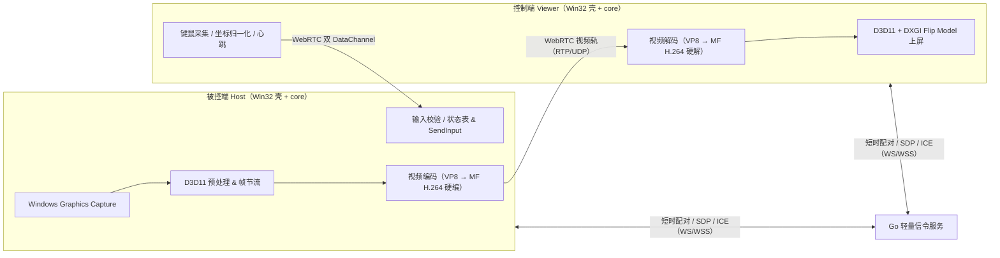

# Windows 远程 Windows 设计方案（v1）

## 1. 目标与边界

### 首版目标
让**两台 Windows 11 x64 电脑（SDR 模式）在有线局域网内完成单屏观看和键鼠控制**。被控端在已登录的交互式用户会话中启动，由本机用户选择共享屏幕并确认连接。
- **第一阶段里程碑（功能基线）**：做到 **720p30 可看、可控、可断开，并能测出端到端与各段耗时**，以此作为衡量硬编硬解收益的基线。
- **优化阶段里程碑（性能验证）**：在指定双机环境下做到 **1080p60 持续动画平均 ≥55 fps、画面延迟 P95 ≤120 ms**。

整体架构主线参考网易 UU 远程（原生 C++ 引擎解耦 + `libwebrtc` 实时传输 + 原生 D3D11 上屏 + 独立编解码探测），并在 Windows GPU 零拷贝硬编、静止画面清晰度、节流与输入安全清理等底层细节上吸收开源方案的工程实践。产品采用自己的会话协议和界面。

### 首版明确非目标（Out of Scope）
以下能力**不进入首版**，避免前期范围蔓延，待 v1 验收后再按需演进：
- 音频采集/回传、麦克风透传
- 剪贴板同步与文件传输
- 系统全局热键透传（如 `Win`、`Alt+Tab`、`Ctrl+Alt+Del`）
- Windows 系统服务（Session 0）、锁屏/登录界面与 UAC 管理员弹窗控制
- 多屏同时观看或会话中动态切屏
- 公网 NAT 穿透与 TURN 中继部署
- 内核/虚拟驱动（虚拟显示器 IddCx、虚拟 HID 键鼠、虚拟声卡/手柄）
- 独立光标流与本地光标渲染（首版由画面携带光标）

---

## 2. 整体架构与模块划分

### 核心技术选型

| 模块 | 首版实现 |
| --- | --- |
| **采集** | C++/WinRT 调用 `Windows.Graphics.Capture`（WGC），由用户选择一个显示器。通过 D3D11 帧池获取 BGRA 纹理，用 `ContentSize` 识别尺寸变化并重建帧池。抽象 `IVideoCapturer` 接口，为未来扩展 DXGI Desktop Duplication 预留位置。[Microsoft 屏幕采集文档](https://learn.microsoft.com/en-us/windows/apps/develop/media-authoring-processing/screen-capture) |
| **传输** | 使用**Windows 预编译原生 `libwebrtc`**（如 `shiguredo/webrtc-build` 或 LiveKit 预编译包），固定版本号与发行产物；单路视频轨 + 双 DataChannel。Host 确认接受会话后才开始推流和接收输入。[WebRTC 信令与建连](https://webrtc.org/getting-started/peer-connections) |
| **信令** | **Go** 编写的轻量独立 WebSocket 信令服务，负责短时配对码、会话授权转发与 SDP/ICE 交换。生产/联调支持 WSS（局域网自签名证书 + 客户端 SHA-256 指纹固定），本地开发期提供可配置的明文 WS 开关以降低调试摩擦。 |
| **编解码** | 跨机初通（实验 B）先用预编译 `libwebrtc` 自带的 **VP8** 编解码器。H.264 硬编硬解先通过独立探测工具用 **Windows Media Foundation（MF）** 单机验证，再以自定义 `VideoEncoderFactory` / `VideoDecoderFactory` 接入 WebRTC。[Microsoft H.264 编码器](https://learn.microsoft.com/en-us/windows/win32/medfound/h-264-video-encoder)、[WebRTC 编码器工厂](https://webrtc.googlesource.com/src/+/refs/heads/main/api/video_codecs/video_encoder_factory.h) |
| **显示** | Viewer 使用 D3D11 和 DXGI Flip Model 交换链，把解码帧直接呈现到专用 `HWND`。实验阶段采用极简原生 Win32 窗口；未来接入 Qt 时由 Qt 管窗口控件、引擎继续接管原生渲染表面。[Microsoft DXGI 窗口交换链](https://learn.microsoft.com/en-us/windows/win32/api/dxgi1_2/nf-dxgi1_2-idxgifactory2-createswapchainforhwnd) |
| **输入** | Viewer 捕获键鼠事件并附带时间戳与归一化坐标，Host 在专用注入线程中调用 `SendInput`。首版输入范围限于普通交互式桌面应用（受 Windows UIPI 限制）。[WebRTC DataChannel](https://datatracker.ietf.org/doc/html/rfc8831)、[Microsoft SendInput](https://learn.microsoft.com/en-us/windows/win32/api/winuser/nf-winuser-sendinput) |

### 工程结构与构建约定
客户端采用 **C++20、CMake、Win32 和 C++/WinRT**，通过 **`vcpkg`（manifest 模式 `vcpkg.json`）** 管理第三方库（如 `spdlog`、`nlohmann-json`、`gtest` 等）；`libwebrtc` 单独以固定版本的预编译包引入。进入实验 B 前，需先验证两台实验机上的 MSVC 工具集、CRT 链接模式（统一 `/MT` 或 `/MD`）与预编译 `libwebrtc` 完全匹配，并确认自定义编解码器工厂及 `VideoFrameBuffer::Type::kNative` 可正常编译链接。

仓库按职责拆分为 6 个模块，从第一天起保证核心引擎与 UI 壳解耦：

| 目录 / 模块 | 语言 | 职责边界 |
| --- | --- | --- |
| `proto/` | C++20 静态库 | 协议编解码与版本/能力校验（**零 IO、无异步依赖**，配套单元测试）。信令消息用 JSON，高频键鼠/心跳用定长二进制结构。 |
| `core/` | C++20 库 | 核心串流引擎（采集、预处理、编解码、WebRTC 会话、D3D11 渲染、输入注入、逐帧打点）。对外只暴露粗粒度会话控制、`HWND` 绑定、输入提交与统计回调。 |
| `codec_probe/` | C++20 可执行程序 | **独立子进程编解码探测与实验 D 验证工具**。隔离各家显卡驱动初始化风险，输出可用 MFT 能力缓存；配合 `codec_policy.json` 支持按适配器 LUID 指定显卡或强制回退 VP8。 |
| `host/` | C++20 Win32 | 被控端极简外壳：选屏、显示配对码、确认连接与一键断开。 |
| `viewer/` | C++20 Win32 | 控制端极简外壳：输入配对码、管理渲染窗口、抓取键鼠与展示基础状态栏。 |
| `signaling/` | Go | 轻量信令服务端（`net/http` + WebSocket），无持久化数据库，纯内存管理短时房间与配对超时。 |

---

## 3. 端到端低延迟与关键实现细节

### 3.1 采集、静止帧与清晰度控制
- **严控队列深度与时间戳节流**：采集到编码之间最多保留 **1–2 帧**，积压时优先淘汰过期的原始帧。帧率限制依据帧的**采集时间戳**做节流（Pacer），不按“上一帧编完再等间隔”，避免单帧处理抖动累积成持续延迟或周期性跳帧。
- **缓存最新帧与“静止后补画质”**：WGC 为画面变化驱动，静止桌面不触发新帧回调。Host 端缓存最近一帧 D3D11 纹理，用于两个场景：
  1. 刚建连首帧发送，以及 WebRTC 收到丢包 PLI/FIR 关键帧请求时的即时重编；
  2. **静止补画质**：滚动或切换窗口后，若画面静止超过约 **200 ms**，把缓存帧再送入编码器补编若干帧残差（上限 6–8 帧，直到输出码流体积降至极低为止），快速把模糊文字补齐至接近无损，随后停止发送。
- **画面只缩放一次**：Viewer 将视频实际显示的**物理设备像素尺寸**通知 Host（不超过目标上限），由 Host 端一次缩放到位，Viewer 按 1:1 设备像素对齐绘制，避免二次缩放导致文字发虚。
- **色彩空间统一**：首版限定 SDR；从 `BGRA → NV12` 预处理到解码后上屏，全链路统一采用 **BT.709（有限范围）**，防止发灰或色偏。

### 3.2 GPU 零拷贝与低延迟管线配置（WebRTC / MF / DXGI）
- **GPU 零拷贝与同显卡约束**：实验 D 接入 Media Foundation 硬编时，在同一块 `ID3D11Device` 上通过 `ID3D11VideoProcessor` 完成缩放与 `BGRA → NV12` 转换，再经 `MFCreateDXGISurfaceBuffer` 和 `IMFDXGIDeviceManager` 直接喂给异步硬件 MFT（内部用事件轮询封装成“一进一出”同步调用）。在双显卡设备上，枚举 MFT 时**必须按适配器 LUID 匹配与采集同一块 GPU 的编码器**。[Microsoft Direct3D 感知 MFT](https://learn.microsoft.com/en-us/windows/win32/medfound/direct3d-aware-mfts)
- **编码器低延迟参数**：硬件 H.264 MFT 必须显式设置低延迟模式（`CODECAPI_AVLowLatencyMode = TRUE`）、**关闭 B 帧**（`CODECAPI_AVEncMPVDefaultBPictureCount = 0`）与超长 GOP（仅在首帧及 WebRTC 请求关键帧时插 I 帧）。
- **WebRTC 低延迟与 `kNative` 透传**：
  - 自定义 `webrtc::VideoFrameBuffer` 子类（`Type::kNative`）在 Host 采集→硬编、Viewer 硬解→D3D11 渲染间直接透传 `ID3D11Texture2D`，避免 `GPU → CPU I420 → GPU` 往返拷贝（同时保留 `ToI420()` 兜底以兼容 VP8/软件回退）。
  - 接收端设置 `SetJitterBufferMinimumDelay(0)`（并启用 RTP `playout-delay` 扩展设为 `min=0, max=0`），削减默认视频会议抖动缓冲。
  - 发送端将 `DegradationPreference` 设为 `MAINTAIN_RESOLUTION`，优先保障桌面文字清晰度。
- **DXGI 低延迟上屏**：交换链采用 Flip Model（`DXGI_SWAP_EFFECT_FLIP_DISCARD`），启用 `DXGI_SWAP_CHAIN_FLAG_FRAME_LATENCY_WAITABLE_OBJECT` 并将最大帧延迟（`SetMaximumFrameLatency`）设为 **1**，防止驱动层额外缓存 2–3 帧。

### 3.3 键鼠输入、坐标映射与状态清理
- **双 DataChannel 与防乱序回跳**：
  - **可靠有序通道**（`ordered=true`）：键盘事件、鼠标按键按下/抬起、滚轮、显示尺寸与控制指令。
  - **无序不可靠通道**（`ordered=false, maxRetransmits=0`）：鼠标移动事件。每条移动消息携带单调递增序号 `seq`，Host 丢弃 `seq <= last_seq` 的乱序旧包，避免光标回跳。
- **DPI 感知与虚拟桌面坐标映射**：
  - Host 和 Viewer 均在应用 Manifest 中声明 **Per-Monitor DPI Aware v2**，杜绝 150% DPI 下的系统坐标虚拟化偏移。
  - Viewer 根据视频实际显示矩形扣除黑边，将归一化坐标 `(u, v)` 与当前坐标映射版本号附在鼠标点击事件里。
  - Host 端结合被共享显示器矩形与虚拟桌面指标（`SM_XVIRTUALSCREEN` / `SM_YVIRTUALSCREEN` / `SM_CXVIRTUALSCREEN` / `SM_CYVIRTUALSCREEN`），统一通过 `MOUSEEVENTF_ABSOLUTE | MOUSEEVENTF_VIRTUALDESK` 映射到 `[0, 65535]`（兼容副屏及负坐标显示器）。点击时在**同一次 `SendInput` 调用中批量提交 `[MOVE, DOWN/UP]` 两条记录**，兼顾落点准确与目标应用兼容性。[Microsoft 鼠标绝对坐标文档](https://learn.microsoft.com/en-us/windows/win32/api/winuser/ns-winuser-mouseinput)
- **键盘扫描码与光标策略**：
  - 键盘全部采用硬件扫描码（`KEYEVENTF_SCANCODE`），并按扫描码正确补齐 **`KEYEVENTF_EXTENDEDKEY`**（方向键、Home/End/PgUp/PgDn、Insert/Delete、右 Ctrl/Alt、小键盘 Enter 等）。
  - 首版光标采用 **WGC 采集开启光标（`IsCursorCaptureEnabled = true`）+ Viewer 聚焦控制时隐藏本地鼠标指针**，避免本地与远端双光标重影。
- **断线释放与过时输入拦截**：
  - Host 在专用输入线程中维护远端按下的键与鼠标按钮状态表；会话关闭、本机结束共享、Viewer 失焦时立即释放。
  - 不单纯依赖 WebRTC ICE 断连回调（拔网线通常需 3–5 秒才触发）：Viewer 在有键鼠处于按下态时，每 **100–200 ms** 发送轻量输入心跳；Host 超过 **500–800 ms** 未收到保活，或检测到因临时卡顿延迟到达的过时输入批（如晚于基准超过 2 秒），立即丢弃过时输入并主动释放所有已按下的按键。

---

## 4. 可观测性与延迟测量

媒体帧结构体从实验 A 起即携带统一元数据：`frame_id`、`capture_qpc`、`width`、`height`、`pixel_format`、`color_space`。

- **端内分段耗时（`QueryPerformanceCounter`）**：
  - Host 记录：`采集完成 → 预处理完成 → 编码完成 → 送入 WebRTC`。
  - Viewer 记录：`收帧/解码开始 → 解码完成 → Present 上屏完成`。
  - 统计各段 P50/P95、接收/解码/渲染帧率、丢帧数与采集队列深度，支持导出 CSV 复盘。
- **跨机真实端到端（Glass-to-Glass）延迟**：使用 120 或 240 fps 相机同时拍摄两台显示器，让 Host 运行周期性变色/帧号递增测试图，通过同一段录像数帧差计算真实 P50/P95 延迟。

---

## 5. 分阶段实验与验收标准

| 实验 | 实现内容 | 通过标准 |
| --- | --- | --- |
| **A · 本机采集与上屏** | 单机搭建 `core` 基础骨架：WGC 采集到 D3D11 纹理，经 DXGI Flip Model（最大帧延迟 1）直接绘制到 Win32 窗口，接入帧元数据与分段计时。用持续移动的测试图观察帧率。 | 1080p 持续运行 10 分钟。画面方向、颜色、缩放比例正确；调整 Viewer 窗口大小及触发分辨率变化后能自动重建并正常显示。 |
| **B · 两机只看画面** | 引入预编译 `libwebrtc` 与 Go 信令服务。Host 采集并送入 WebRTC（先跑 VP8），Viewer 接收、解码并上屏；配好 `SetJitterBufferMinimumDelay(0)` 与 `MAINTAIN_RESOLUTION`，记录收流、解码和呈现帧率。 | 有线局域网下 **720p30** 连续运行 10 分钟；重复连接/断开 5 次均无资源泄漏或卡死；持续动画场景下相机实测端到端延迟 **P95 ≤150 ms**。 |
| **C · 回传键鼠与状态安全** | 加入配对码与本机授权、`proto` 二进制输入协议、双 DataChannel（移动带 `seq`）、扫描码与扩展键、`PerMonitorV2` + `VIRTUALDESK` 坐标映射、隐藏本地光标及应用层心跳释键。用记事本、拖拽、副屏与组合键验证。 | 在 **100%、150% DPI**、带黑边窗口及副屏共享下点击位置准确；方向键/组合键/拖拽正常；按住修饰键拔掉网线后，Host 在 **1 秒内**释放按键（不等 ICE 超时）。 |
| **D · 硬编硬解与性能达标** | 先用独立进程 `codec_probe` 单机跑通 `BGRA → D3D11VideoProcessor(NV12/BT.709) → 同显卡 MF H.264 编码 → 解码 → D3D11 上屏`，记录选中的适配器与 MFT；再接入 WebRTC 编解码器工厂（`kNative` 零拷贝）与静止补画质。 | 指定两台测试机在有线局域网下 **1080p60** 持续动画 10 分钟：Viewer 实际呈现平均 **≥55 fps**，相机实测端到端延迟 **P95 ≤120 ms**；滚动停止后文字迅速恢复清晰；完整记录 CPU、GPU、丢帧与队列深度基线。 |

---

## 6. v1 之后的演进预留

在完成实验 A–D 验收后，可在不推翻 `core` 与 `proto` 骨架的前提下按需增量扩展：
1. **体验升级**：增加 DXGI Desktop Duplication 采集后端，分离硬件光标形状（槽位缓存）并在 Viewer 端本地绘制，进一步降低鼠标操作体感延迟。
2. **系统级受控**：参照“单二进制 `--service` + `--agent`”模式，由 Session 0 系统服务拉起控制台会话进程并切换至当前输入桌面（`OpenInputDesktop` / `SetThreadDesktop`），在**不引入内核驱动**的前提下支持 UAC 与锁屏操作。
3. **外壳与外围能力**：将 `host` / `viewer` 的 Win32 壳替换为 Qt 界面，并逐步补齐音频（Opus）、剪贴板同步及崩溃 Minidump 收集。
